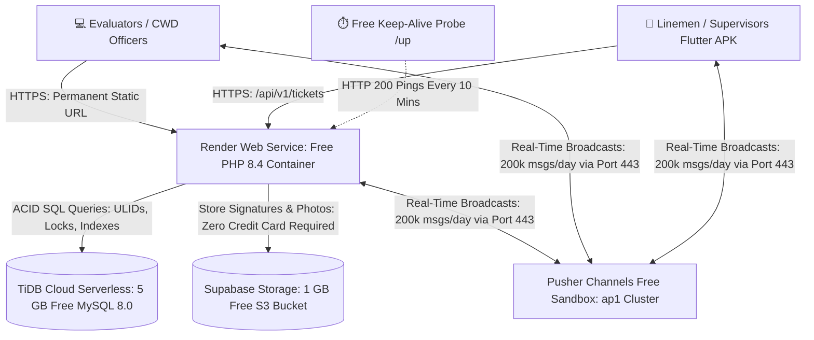

# PALECO OTRS-CRM: Cloud Deployment & UAT Master Guide

> **Project:** PALECO OTRS-CRM (Utility Service Ticket & Dispatch Management System)  
> **Target Audience:** Development Team, DevOps Engineers, and Mobile Engineers  
> **Document Version:** 2.1 (Multi-Platform Cloud Architecture with Supabase Zero-Credit-Card Storage)  
> **Target Path:** `docs/dev/CLOUD_DEPLOYMENT_AND_UAT_MASTER_GUIDE.md`  
> **Hosting Architecture:** Render.com (Web & Compute) + TiDB Cloud (5 GB Serverless MySQL 8.0) + Supabase Storage (1 GB Free S3 Object Storage - Zero Credit Card) + Pusher Channels Sandbox (200,000 Real-Time Msgs/Day) + UptimeRobot (Keep-Alive Health Probe)

---

## 1. High-Level Architecture Overview

Free-tier cloud containers (like Render, Koyeb, or Railway) are **stateless and single-port**. To run an enterprise Laravel system with real-time WebSockets, ACID relational transactions, and persistent image uploads **strictly without credit cards, fees, or paid custom domains**, we decouple into five specialized zero-cost cloud platforms:



### The 5 Decoupled Cloud Components

| Role | Provider | Free Allowance | Why It Is Used |
| :--- | :--- | :--- | :--- |
| **Compute & Web** | **Render.com** | 512 MB RAM, Free SSL | Hosts Laravel 11/PHP 8.4, handles HTTP requests, auto-deploys on `git push`. (No card needed). |
| **Database** | **TiDB Cloud** | 5 GB Free Forever | 100% MySQL 8.0 wire-compatible; supports ULIDs, transactions, and row-level `lockForUpdate()`. (No card needed). |
| **Media Storage** | **Supabase Storage** | 1 GB Free Forever, 2 GB/mo Egress | S3-compatible cloud storage for accomplishment photos and canvas signatures. **100% Free via GitHub sign-in, strictly NO credit card required**. |
| **Real-Time WebSockets** | **Pusher Channels** | 200,000 msgs/day, 100 connections | Pushes instant dispatches over HTTPS port 443 without requiring custom open firewall ports. Supported natively by Laravel Echo & Flutter. |
| **Uptime & Health** | **UptimeRobot** | 50 Monitors, 5-min checks | Pings `/up` health probe every 10 minutes to prevent Render free container from entering sleep state. |

---

## 2. Step-by-Step Platform Setup

### Step 1: Set Up TiDB Cloud (5 GB Free MySQL 8.0)
1. Sign up for free at [tidbcloud.com](https://tidbcloud.com).
2. Click **Create Cluster** $\to$ Select **Serverless** (Free $0.00).
3. Choose region: **Singapore (`ap-southeast-1`)** for lowest network latency to the Philippines.
4. Set a cluster name: `paleco-crm-db`.
5. Once created, click **Connect** $\to$ Select **Connection Type: General**.
6. Note down your connection parameters:
   - **Host:** e.g., `gateway01.ap-southeast-1.prod.aws.tidbcloud.com`
   - **Port:** `4000`
   - **User:** e.g., `xxxxxx.root`
   - **Password:** *(The secure password generated)*
   - **Database:** `paleco_crm` (or `test`)

---

### Step 2: Set Up Supabase Storage (1 GB Free S3-Compatible Storage - No Credit Card)
1. Sign up or log in at [supabase.com](https://supabase.com) using your **GitHub account**. **Strictly NO credit card is required.**
2. Click **New Project**:
   - **Name:** `paleco-crm-storage`
   - **Database Password:** *(Set any strong password)*
   - **Region:** **Singapore (`ap-southeast-1`)**
   - **Pricing Plan:** **Free Tier ($0/month)**
3. In the left navigation bar, click **Storage**:
   - Click **New Bucket**.
   - Bucket Name: `paleco-media`
   - **Public bucket:** Toggle **ON** (allows accomplishment photos and canvas signatures to be viewed over HTTPS in web browsers and the mobile app without requiring signed URLs).
   - Click **Save**.
4. Generate S3-Compatible Access Credentials:
   - Click the gear icon (**Project Settings**) at the bottom left $\to$ **Storage**.
   - Under **S3 Access Keys**, click **New access key** (or **Generate Access Key**).
   - Name the key: `render-backend`.
   - Copy and securely save the credentials:
     - **Access Key ID:** e.g., `a1b2c3d4e5f6...`
     - **Secret Access Key:** e.g., `xxxxxxxxxxxxxxxxxxxxxxxxxxxxxxxx`
     - **Endpoint URL:** `https://<PROJECT_REF>.supabase.co/storage/v1/s3`
     - **Public Storage Base URL:** `https://<PROJECT_REF>.supabase.co/storage/v1/object/public/paleco-media`


---

### Step 3: Set Up Pusher Channels (200,000 Free Messages/Day)
1. Sign up for free at [pusher.com](https://pusher.com).
2. In the dashboard, click **Create app**:
   - App Name: `paleco-crm`
   - Cluster: **`ap1` (Singapore)**
   - Frontend tech: `Flutter` / `Vanilla JS`
   - Backend tech: `Laravel`
3. Click **Create app**.
4. Go to **App Keys** and copy:
   - `app_id`
   - `key`
   - `secret`
   - `cluster` (e.g. `ap1`)

---

### Step 4: Deploy the Web App on Render.com
1. Sign up for free at [render.com](https://render.com) using your GitHub account.
2. In the Render Dashboard, click **New +** $\to$ **Web Service**.
3. Select **Build and deploy from a Git repository** $\to$ Connect your PALECO repository.
4. Fill in the service configuration:
   - **Name:** `paleco-crm` (Your URL will be `https://paleco-crm.onrender.com`)
   - **Region:** **Singapore**
   - **Branch:** `master`
   - **Root Directory:** `PALECO_OTRS-CRM`
   - **Runtime:** **PHP**
   - **Build Command:**
     ```bash
     composer install --no-dev --optimize-autoloader && npm ci && npm run build
     ```
   - **Start Command:**
     ```bash
     php artisan migrate --force && php artisan config:cache && php artisan route:cache && php artisan view:cache && apache2-foreground
     ```
   - **Instance Type:** **Free (512 MB)**

#### 4.1 Render Environment Variables
In the **Environment** tab on Render, add the following variables:

```ini
APP_NAME="PALECO OTRS-CRM"
APP_ENV=production
APP_KEY=base64:1n0P6JceEy0bFN6J5sz+aWEzNrccNAim0Ei0B8r8MT0=
APP_DEBUG=false
APP_URL=https://paleco-crm.onrender.com

LOG_CHANNEL=stderr
LOG_LEVEL=error

# TiDB Database Connection
DB_CONNECTION=mysql
DB_HOST=gateway01.ap-southeast-1.prod.aws.tidbcloud.com
DB_PORT=4000
DB_DATABASE=paleco_crm
DB_USERNAME=your_tidb_username
DB_PASSWORD=your_tidb_password
MYSQL_ATTR_SSL_CA=/etc/ssl/certs/ca-certificates.crt

# Session, Cache & Queue on Database
SESSION_DRIVER=database
SESSION_LIFETIME=120
CACHE_STORE=database
QUEUE_CONNECTION=sync

# Real-Time WebSockets via Pusher Free Sandbox
BROADCAST_CONNECTION=pusher
PUSHER_APP_ID=your_pusher_app_id
PUSHER_APP_KEY=your_pusher_key
PUSHER_APP_SECRET=your_pusher_secret
PUSHER_APP_CLUSTER=ap1

VITE_PUSHER_APP_KEY="${PUSHER_APP_KEY}"
VITE_PUSHER_APP_CLUSTER="${PUSHER_APP_CLUSTER}"

# Media Storage via Supabase Storage (S3-Compatible Driver - Zero Credit Card)
FILESYSTEM_DISK=s3
AWS_ACCESS_KEY_ID=your_supabase_access_key_id
AWS_SECRET_ACCESS_KEY=your_supabase_secret_access_key
AWS_DEFAULT_REGION=ap-southeast-1
AWS_BUCKET=paleco-media
AWS_ENDPOINT=https://your_project_ref.supabase.co/storage/v1/s3
AWS_USE_PATH_STYLE_ENDPOINT=true
AWS_URL=https://your_project_ref.supabase.co/storage/v1/object/public/paleco-media
```

5. Click **Create Web Service**. Render pulls the code, installs dependencies, builds Vite assets, runs migrations, and deploys!

---

### Step 5: Prevent Free Container Sleep (Keep-Alive Ping)
Free Render containers sleep after 15 minutes of inactivity. Pinging Laravel's lightweight health probe `/up` keeps the backend responsive 24/7 during UAT:

1. Sign up for free at [uptimerobot.com](https://uptimerobot.com).
2. Click **Add New Monitor**:
   - **Monitor Type:** `HTTP(s)`
   - **Friendly Name:** `PALECO UAT Keep-Alive`
   - **URL (or IP):** `https://paleco-crm.onrender.com/up`
   - **Monitoring Interval:** Every **10 minutes**
3. Click **Create Monitor**.

---

### Step 6: Configure the Flutter Mobile App (Build Once)

Now that you have a permanent cloud URL, configure the Flutter app to target the v1 REST API and Pusher cluster:

#### 6.1 Environment Settings in Flutter (`lib/config/api_config.dart`)
```dart
class ApiConfig {
  // Permanent Static Cloud Base URL with v1 versioning
  static const String baseUrl = 'https://paleco-crm.onrender.com/api/v1';
  
  // Real-Time Pusher Configuration (Port 443 TLS)
  static const String pusherApiKey = 'your_pusher_key';
  static const String pusherCluster = 'ap1';
  static const String authEndpoint = 'https://paleco-crm.onrender.com/api/v1/broadcasting/auth';
}
```

#### 6.2 Build the Release APK
```bash
flutter build apk --release
```
The compiled APK (`build/app/outputs/flutter-apk/app-release.apk`) can now be distributed to linemen and supervisors.

---

## 3. Comprehensive Multi-Platform Deployment Checklist

Use this exhaustive checklist to track every single operational step:

### Phase 1: Pre-Deployment Repository & Codebase Sanity
- [ ] Run `git status` to ensure all changes are committed on branch `master`.
- [ ] Verify `composer.json` contains `"league/flysystem-aws-s3-v3": "^3.0"` for Supabase Storage (S3 API) support.
- [ ] Verify `composer.json` contains `"pusher/pusher-php-server": "^7.3"` for cloud WebSockets.
- [ ] Verify API routes enforce `/api/v1/` prefix in `routes/api.php`.
- [ ] Verify password constraints in `StoreUserRequest.php` enforce `Password::min(8)->mixedCase()`.
- [ ] Verify `TicketCreated.php` broadcasts to both `private-cwd.operations` and `private-department.{id}`.
- [ ] Verify `WebDashboardService.php` contains null-safe causer handling for audit events (`$actor?->fullName`).
- [ ] Run automated test suite: `php artisan test` (Confirm **19 passed, 98 assertions, 0 failures**).

### Phase 2: TiDB Cloud Database Provisioning
- [ ] Create free Serverless cluster in Singapore (`ap-southeast-1`).
- [ ] Create database named `paleco_crm`.
- [ ] Save host address, port `4000`, username, and password securely.
- [ ] Whitelist `0.0.0.0/0` (TiDB Serverless enforces mandatory TLS/SSL certificate encryption).
- [ ] Test direct SQL connection using MySQL Workbench or CLI with SSL flag enabled.

### Phase 3: Supabase Storage Provisioning (Zero Credit Card Required)
- [ ] Sign up or log into [supabase.com](https://supabase.com) using your GitHub account (No card needed).
- [ ] Create free project `paleco-crm-storage` in Singapore (`ap-southeast-1`).
- [ ] Navigate to **Storage** $\to$ Click **New Bucket**.
  - Bucket Name: `paleco-media`
  - Set **Public bucket**: Toggle ON.
- [ ] Navigate to **Project Settings** (gear icon) $\to$ **Storage** $\to$ **S3 Access Keys**.
- [ ] Click **New access key** (or **Generate Access Key**).
- [ ] Copy and securely save:
  - `Access Key ID`
  - `Secret Access Key`
  - `Endpoint URL`: `https://<PROJECT_REF>.supabase.co/storage/v1/s3`
  - `Public Storage Base URL`: `https://<PROJECT_REF>.supabase.co/storage/v1/object/public/paleco-media`

### Phase 4: Pusher Channels Real-Time Gateway Setup
- [ ] Create free app `paleco-crm` in Singapore cluster (`ap1`).
- [ ] Copy `app_id`, `key`, `secret`, and `cluster`.
- [ ] Verify client event settings: enable authorized private channels.
- [ ] Confirm `channels.php` uses `['guards' => ['web', 'sanctum']]` for authorization.

### Phase 5: Render.com Web Service Deployment
- [ ] Connect GitHub repository `master` branch.
- [ ] Set Root Directory: `PALECO_OTRS-CRM`.
- [ ] Set Environment: `PHP`.
- [ ] Enter Build Command:
  ```bash
  composer install --no-dev --optimize-autoloader && npm ci && npm run build
  ```
- [ ] Enter Start Command:
  ```bash
  php artisan migrate --force && php artisan config:cache && php artisan route:cache && php artisan view:cache && apache2-foreground
  ```
- [ ] Configure all Environment Variables in the Render Dashboard (Section 2, Step 4.1).
- [ ] Trigger manual deploy and monitor the deployment log.
- [ ] Confirm build output shows `Vite: built in ...` and `DONE Running migrations`.

### Phase 6: Initial Database Seeding on Cloud
- [ ] Open the Render Web Shell (in Render Dashboard $\to$ **Shell** tab).
- [ ] Seed default catalog and test users:
  ```bash
  php artisan db:seed --force
  ```
- [ ] Confirm seeding completion:
  - `RoleSeeder` DONE
  - `DepartmentSeeder` DONE
  - `TeamSeeder` DONE
  - `TicketCategorySeeder` DONE
  - `UserSeeder` DONE (All test accounts seeded with `Password`)

### Phase 7: UptimeRobot Keep-Alive Configuration
- [ ] Create HTTP(s) monitor pointing to `https://paleco-crm.onrender.com/up`.
- [ ] Set monitoring frequency to **10 minutes**.
- [ ] Verify initial probe returns HTTP `200 OK`.

### Phase 8: Mobile Application (Flutter APK) Re-Targeting
- [ ] Update `lib/config/api_config.dart` with:
  - `baseUrl: 'https://paleco-crm.onrender.com/api/v1'`
  - `authEndpoint: 'https://paleco-crm.onrender.com/api/v1/broadcasting/auth'`
  - `pusherApiKey: '<PUSHER_KEY>'`
  - `pusherCluster: 'ap1'`
- [ ] Compile release APK: `flutter build apk --release`.
- [ ] Install APK on field test Android device or emulator.

### Phase 9: End-to-End Cloud UAT Operational Verification Matrix
Perform this live test sequence to verify all platforms are cooperating:

1. **Web Admin Login:**
   - Navigate to `https://paleco-crm.onrender.com/login/admin`.
   - Log in as `allenglenn` / `Password`.
   - Verify Admin Dashboard loads cleanly with KPI cards and Activity Trail without 500 errors.
2. **CWD Officer Login & Intake:**
   - In private window, navigate to `https://paleco-crm.onrender.com/login/cwd`.
   - Log in as `alliah` / `Password`.
   - Open ticket creation form, search consumer (or create unlinked), and submit a new complaint.
   - Confirm ticket appears in CWD ticket queue table.
3. **Mobile Supervisor Authentication & Live Sync:**
   - Launch mobile app/simulator, log in as `mycka` / `Password`.
   - Verify ticket submitted by CWD appears in supervisor's inbox in real time via Pusher WebSocket.
   - Assign the ticket to field crew `ralph` (Crew Alpha).
4. **Field Lineman Execution & Proof Upload:**
   - Log into mobile app as `ralph` / `Password`.
   - View assigned ticket, tap **Start Work**.
   - Capture canvas signature and upload accomplishment photo.
   - Tap **Submit Accomplishment**.
5. **Supabase Storage Verification:**
   - Open CWD or Admin ticket detail view on web.
   - Inspect the uploaded accomplishment report.
   - Right-click image and verify URL points to Supabase public storage (`https://<project-ref>.supabase.co/storage/v1/object/public/paleco-media/...`).
   - Confirm photo and signature render cleanly.
6. **Supervisor Verification & Closure:**
   - On mobile app as `mycka`, review submitted proof and tap **Approve & Close**.
   - Verify web desk updates status badge to `Resolved` / `Closed` instantly.

---

## 4. Post-UAT Suspension & Teardown Runbook

### Scenario A: Temporary Suspension (Pause Everything, Keep All Data)
Use when testing is paused until the next evaluation session:
1. **Pause UptimeRobot:** In [uptimerobot.com](https://uptimerobot.com), click the pause button on the monitor.
2. **Suspend Render Service:** In [render.com](https://render.com) $\to$ Settings $\to$ Danger Zone $\to$ click **Suspend Web Service**.
3. **Pause TiDB Cluster (Optional):** In [tidbcloud.com](https://tidbcloud.com), click `...` on cluster $\to$ **Pause**.
*All data, accounts, tickets, and photos remain safely preserved for $0.00.*

### Scenario B: Permanent Deletion (Complete Post-Capstone Teardown)
Use when the capstone is finished and grades are recorded:
1. **Render:** Settings $\to$ Danger Zone $\to$ **Delete Web Service**.
2. **TiDB Cloud:** Cluster overview $\to$ `...` $\to$ **Delete Cluster**.
3. **Supabase Storage:** Project Settings $\to$ General $\to$ **Delete Project**; or Storage $\to$ **Delete Bucket**.
4. **Pusher:** App settings $\to$ **Delete App**.
5. **UptimeRobot:** Monitor settings $\to$ **Delete Monitor**.
*Leaves zero residual accounts, tokens, or cloud footprint.*

