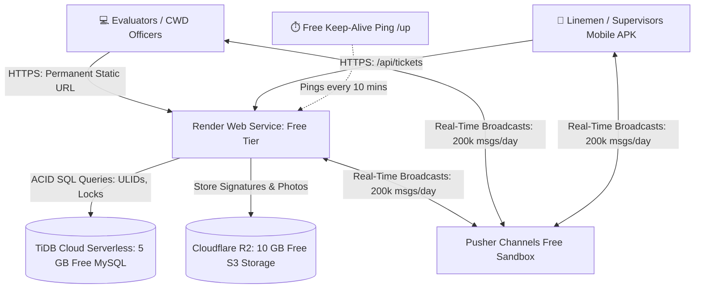
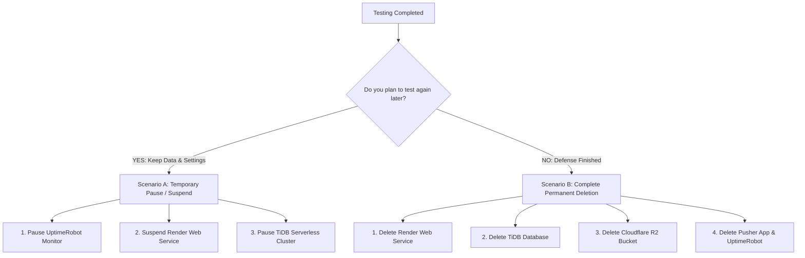

# PALECO OTRS-CRM: Cloud Deployment & UAT Master Guide

**Target Audience:** Development Team, DevOps, and Mobile Engineers  
**Document Version:** 1.0  
**Target Path:** `docs/dev/CLOUD_DEPLOYMENT_AND_UAT_MASTER_GUIDE.md`  
**Hosting Architecture:** Render (Free Web Service) + TiDB Cloud (5 GB Free Serverless MySQL) + Cloudflare R2 (10 GB Free S3 Object Storage) + Pusher Channels Sandbox (200k Free Real-Time Messages/Day)

---

## 1. High-Level Architecture Overview

Free-tier cloud containers (like Render, Koyeb, or Railway) are **stateless and single-port**. To run an enterprise Laravel system with WebSockets, databases, and image uploads without paying monthly fees or buying a custom domain name, we decouple into four specialized free-tier services:



### The 4 Free Components

| Role | Provider | Free Allowance | Why It Is Used |
| :--- | :--- | :--- | :--- |
| **Compute & Web** | **Render.com** | 512 MB RAM, Free SSL | Hosts Laravel, handles HTTP requests, auto-deploys on `git push`. |
| **Database** | **TiDB Cloud** | 5 GB Free Forever | 100% MySQL 8.0 wire-compatible; supports ULIDs, transactions, and locking. |
| **Media Storage** | **Cloudflare R2** | 10 GB Free Forever | S3-compatible cloud storage for accomplishment photos and signatures. $0 bandwidth fees. |
| **Real-Time WebSockets** | **Pusher Channels** | 200,000 msgs/day, 100 connections | Pushes instant dispatches without requiring a separate open port. Supported by Laravel natively. |

---

## 2. Step 1: Set Up TiDB Cloud (5 GB Free MySQL 8.0)

Render's free tier does not include a persistent MySQL database. TiDB Cloud provides 5 GB of free serverless MySQL 8.0 that never sleeps.

1. Sign up for free at [tidbcloud.com](https://tidbcloud.com).
2. Click **Create Cluster** $\to$ Select **Serverless** (Free $0.00).
3. Choose region: **Singapore (`ap-southeast-1`)** for lowest latency to the Philippines.
4. Set a cluster name: `paleco-crm-db`.
5. Once created, click **Connect** $\to$ Select **Connection Type: General**.
6. Note down your connection parameters:
   - **Host:** e.g., `gateway01.ap-southeast-1.prod.aws.tidbcloud.com`
   - **Port:** `4000`
   - **User:** e.g., `xxxxxx.root`
   - **Password:** *(The password you generated)*
   - **Database:** `test` (or create `paleco_crm`)

---

## 3. Step 2: Set Up Cloudflare R2 (10 GB Free Photo Storage)

Render containers are stateless; any photos uploaded locally are wiped when the container restarts. Cloudflare R2 provides 10 GB of free S3-compatible cloud storage with **zero bandwidth/egress fees**.

1. Sign up for free at [dash.cloudflare.com](https://dash.cloudflare.com). **No domain purchase is required.**
2. In the left sidebar, click **R2 Object Storage**.
3. Click **Create bucket** $\to$ Name it: `paleco-crm-storage` $\to$ Click **Create**.
4. In the bucket settings, under **Public access**, click **Allow Access** or enable **R2.dev subdomain** (this gives you a public URL like `https://pub-xxxxxx.r2.dev` to display photos in the web browser).
5. Go back to **R2 Overview** $\to$ Click **Manage R2 API Tokens** (on the right side).
6. Click **Create API Token**:
   - Permissions: **Object Read & Write**
   - Apply to: **All buckets** (or select `paleco-crm-storage`)
7. Click **Create API Token** and copy the credentials:
   - **Access Key ID:** `xxxxxxxxxxxxxxxxxxxxxxxx`
   - **Secret Access Key:** `xxxxxxxxxxxxxxxxxxxxxxxx`
   - **Endpoint URL:** `https://<ACCOUNT_ID>.r2.cloudflarestorage.com`

---

## 4. Step 3: Set Up Pusher Channels (200,000 Free Messages/Day)

Free cloud containers only expose port 443/80, so running Reverb on port 8080 isn't supported on free single-port web services. Pusher Channels Sandbox is free and already natively supported by Laravel with zero code changes.

1. Sign up for free at [pusher.com](https://pusher.com).
2. In the dashboard, click **Create app**:
   - App Name: `paleco-crm`
   - Cluster: **`ap1` (Singapore)**
   - Frontend tech: `Flutter` / `Vanilla JS`
   - Backend tech: `Laravel`
3. Click **Create app**.
4. Go to **App Keys** and copy:
   - `app_id`
   - `key`
   - `secret`
   - `cluster` (e.g. `ap1`)

---

## 5. Step 4: Deploy the Web App on Render

1. Sign up for free at [render.com](https://render.com) using your GitHub account.
2. In the Render Dashboard, click **New +** $\to$ **Web Service**.
3. Select **Build and deploy from a Git repository** $\to$ Connect your PALECO repository.
4. Fill in the service configuration:
   - **Name:** `paleco-crm` (Your URL will be `https://paleco-crm.onrender.com`)
   - **Region:** **Singapore**
   - **Branch:** `master`
   - **Root Directory:** `PALECO_OTRS-CRM`
   - **Runtime:** **PHP**
   - **Build Command:**
     ```bash
     composer install --no-dev --optimize-autoloader && npm install && npm run build
     ```
   - **Start Command:**
     ```bash
     php artisan migrate --force && php artisan config:cache && php artisan route:cache && php artisan view:cache && apache2-foreground
     ```
   - **Instance Type:** **Free (512 MB)**

### 5.1 Add Environment Variables in Render
In the **Environment** tab on Render, add the following variables:

```ini
APP_NAME="PALECO OTRS-CRM"
APP_ENV=production
APP_KEY=base64:1n0P6JceEy0bFN6J5sz+aWEzNrccNAim0Ei0B8r8MT0=
APP_DEBUG=false
APP_URL=https://paleco-crm.onrender.com

LOG_CHANNEL=stderr
LOG_LEVEL=error

# TiDB Database Connection
DB_CONNECTION=mysql
DB_HOST=gateway01.ap-southeast-1.prod.aws.tidbcloud.com
DB_PORT=4000
DB_DATABASE=paleco_crm
DB_USERNAME=your_tidb_username
DB_PASSWORD=your_tidb_password
MYSQL_ATTR_SSL_CA=/etc/ssl/certs/ca-certificates.crt

# Session & Cache on TiDB Database
SESSION_DRIVER=database
SESSION_LIFETIME=120
CACHE_STORE=database
QUEUE_CONNECTION=sync

# Real-Time WebSockets via Pusher Free Sandbox
BROADCAST_CONNECTION=pusher
PUSHER_APP_ID=your_pusher_app_id
PUSHER_APP_KEY=your_pusher_key
PUSHER_APP_SECRET=your_pusher_secret
PUSHER_APP_CLUSTER=ap1

VITE_PUSHER_APP_KEY="${PUSHER_APP_KEY}"
VITE_PUSHER_APP_CLUSTER="${PUSHER_APP_CLUSTER}"

# Media Storage via Cloudflare R2
FILESYSTEM_DISK=s3
AWS_ACCESS_KEY_ID=your_r2_access_key
AWS_SECRET_ACCESS_KEY=your_r2_secret_key
AWS_DEFAULT_REGION=auto
AWS_BUCKET=paleco-crm-storage
AWS_ENDPOINT=https://your_account_id.r2.cloudflarestorage.com
AWS_USE_PATH_STYLE_ENDPOINT=true
AWS_URL=https://pub-xxxxxx.r2.dev
```

5. Click **Create Web Service**. Render will pull the code, install dependencies, compile Vite assets, run migrations, and deploy!

---

## 6. Step 5: Prevent Free Container Sleep (Keep-Alive Ping)

Free Render containers spin down into a sleep state after 15 minutes of inactivity. The next request can take 30–50 seconds to boot up.

To prevent sleep and keep the backend responsive 24/7 during UAT:

1. Sign up for free at [uptimerobot.com](https://uptimerobot.com) (or [cron-job.org](https://cron-job.org)).
2. Click **Add New Monitor**:
   - **Monitor Type:** `HTTP(s)`
   - **Friendly Name:** `PALECO UAT Keep-Alive`
   - **URL (or IP):** `https://paleco-crm.onrender.com/up` *(Laravel's built-in lightweight health check)*
   - **Monitoring Interval:** Every **10 minutes**
3. Click **Create Monitor**.

---

## 7. Step 6: Configure the Flutter Mobile App (Build Once)

Now that you have a permanent, unchanging cloud URL, your Flutter team configures the app once and builds the release APK:

### 7.1 Environment Settings in Flutter (`lib/config/api_config.dart`)
```dart
class ApiConfig {
  // Permanent Static Cloud Base URL
  static const String baseUrl = 'https://paleco-crm.onrender.com/api';
  
  // Real-Time Pusher Configuration
  static const String pusherApiKey = 'your_pusher_key';
  static const String pusherCluster = 'ap1';
  static const String authEndpoint = 'https://paleco-crm.onrender.com/api/broadcasting/auth';
}
```

### 7.2 Build the Android APK
```bash
flutter build apk --release
```
The compiled APK (`build/app/outputs/flutter-apk/app-release.apk`) can now be distributed to all linemen and supervisors. Because the domain is static and hosted in the cloud:
- Testers can use the app on 4G/5G mobile data from anywhere.
- Evaluators can open `https://paleco-crm.onrender.com` on their laptops.
- The URL **never expires, never resets, and never breaks**.

---

## 8. Summary Comparison: Why This Solves All UAT Pain Points

| Problem Faced with Local Tunnels | How This Decoupled Cloud Architecture Resolves It |
| :--- | :--- |
| **URL changes on restart / laptop sleep** | **Permanent fixed URL:** `https://paleco-crm.onrender.com` never changes. |
| **Must recompile APK and redistribute to testers** | **Build APK once:** Points to the permanent cloud URL. |
| **No domain name owned** | **Zero domain needed:** Free `.onrender.com` SSL subdomain provided. |
| **Linux / Nginx / iptables complexity** | **Zero sysadmin:** Fully managed cloud dashboards; deploys on `git push`. |
| **Free container sleep lag** | **Keep-Alive ping:** UptimeRobot pings `/up` every 10 mins, eliminating wake-up lag. |
| **Uploaded photos wiped on restart** | **Cloudflare R2:** 10 GB persistent cloud storage preserves all proof photos. |

---

## 9. Tear-Down & Suspension Guide (Post-Testing Decommissioning)

Once your UAT testing session, panel demonstration, or capstone evaluation is complete, you can easily take everything down so the system is no longer accessible over the public internet.

You have two choices depending on your situation:



---

### Scenario A: Temporary Suspension (Pause Everything, Keep All Data)

Use this when you finish testing for the day, but plan to do another test run or oral defense next week. This takes **under 60 seconds**:

1. **Step 1: Pause UptimeRobot Keep-Alive Ping**
   - In [uptimerobot.com](https://uptimerobot.com), click the pause icon next to your monitor.
   - *Why:* Prevents UptimeRobot from sending requests and triggering downtime alerts while the service is suspended.
2. **Step 2: Suspend the Render Web Service**
   - In [render.com](https://render.com), click your `paleco-crm` service $\to$ go to the **Settings** tab.
   - Scroll to the bottom to the **Danger Zone** $\to$ click **Suspend Web Service**.
   - *Result:* Render immediately halts the container. Any visitor or mobile app connecting to `https://paleco-crm.onrender.com` will receive a 503 Service Unavailable page.
3. **Step 3: Pause the TiDB Database (Optional)**
   - In [tidbcloud.com](https://tidbcloud.com), on your `paleco-crm-db` cluster, click the three dots (`...`) $\to$ click **Pause**.
   - *Result:* Stops database compute; all tables, users, and ticket records remain safely stored on disk.

#### How to Re-Activate When Ready to Test Again:
- Click **Resume Web Service** on Render.
- Click **Resume** on TiDB.
- Click **Resume** on UptimeRobot.
- **Your system is back online in 30 seconds with all previous data, accounts, and tickets intact.**

---

### Scenario B: Permanent Deletion (Complete Clean-Up)

Use this when your capstone is finished, your final grades are submitted, and you want to permanently remove all cloud resources:

1. **Render:** In Service **Settings** $\to$ Danger Zone $\to$ click **Delete Web Service** $\to$ type the confirmation name.
2. **TiDB Cloud:** In Cluster overview $\to$ click `...` $\to$ click **Delete Cluster** $\to$ confirm.
3. **Cloudflare R2:** In Cloudflare $\to$ **R2** $\to$ click `paleco-crm-storage` $\to$ **Settings** $\to$ scroll down to **Delete Bucket**. Then revoke the API token under **Manage R2 API Tokens**.
4. **Pusher:** In Pusher dashboard $\to$ click `paleco-crm` $\to$ **App Settings** $\to$ scroll to bottom $\to$ click **Delete app**.
5. **UptimeRobot:** In dashboard $\to$ click the gear icon on the monitor $\to$ click **Delete**.

*Result: 100% of cloud resources, API tokens, databases, and uploaded photos are permanently wiped from all cloud providers with zero residual footprint.*

