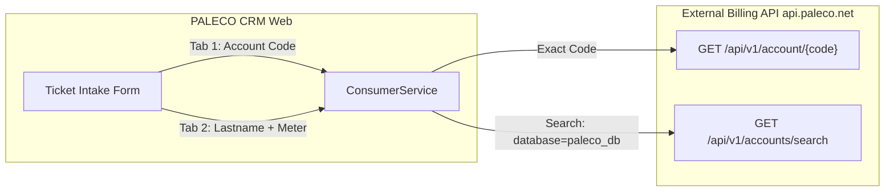
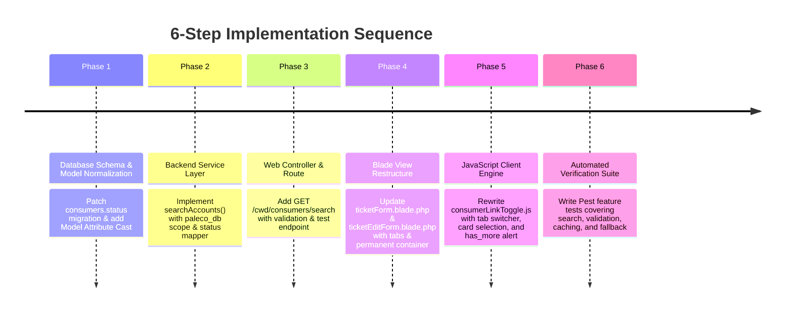

# Architectural & Implementation Plan: Consumer Search & Linking Module Revamp

**Target Audience:** Development Team & Autonomous AI Coding Agents  
**Document Version:** 1.0  
**Target Path:** `docs/dev/CONSUMER_SEARCH_AND_LINKING_MODULE_REVAMP_PLAN.md`  
**Status:** Planning & Architectural Specification (No code modifications in this phase)

---

## 1. Executive Summary & Problem Domain

### 1.1 The Operational Context
Currently, the Central Web Desk (CWD) ticket registration form links consumers exclusively through a single input requiring an **Account Code** (format: `XX-XXXX-XXXX`). It queries `GET /api/v1/account/{accountCode}` directly.

While this is the fastest, most deterministic lookup method, it causes severe operational friction when consumers calling hotlines or reporting outages **do not know their 10-digit account code**. In those scenarios, dispatchers are forced to bypass consumer linking entirely, leading to orphaned tickets and incomplete consumer history.

### 1.2 Core Objectives of the Revamp
1. **Multi-Criteria Search (`/api/v1/accounts/search`):** Enable searching by **Last Name** (required) and **Meter Serial Number** (optional).
2. **Strict Geographic Scope:** Always bind `database=paleco_db` to restrict searches strictly to Puerto Princesa City consumers.
3. **Always-Visible UI Container:** Eliminate the jarring show/hide layout shifts. The CRM Integration container will remain permanently rendered on screen; when the "Link Consumer" checkbox is unchecked, the container remains visible in an **accessible, muted, disabled state (opacity-50, pointer-events-none)**.
4. **Two-Tab Input Workflow:**
   - **Tab 1 (Default): "Account Code"** — High-speed deterministic lookup.
   - **Tab 2: "Search by Name / Meter"** — Flexible fallback lookup for consumers without their bills on hand.
5. **Interactive Card Selection:** Render search results as rich, clickable cards. Selecting an account highlights that card, disables alternative options, stores the selection, and populates the form payload.
6. **`has_more = true` Overflow Handling:** Because the external API does not currently support pagination parameters (`page`/`offset`), if the API indicates more records exist, the UI will proactively alert the user to provide a Meter Serial to narrow the result set.
7. **Status Normalization:** Map the raw single-character status codes (`A`, `D`, `I`, or unexpected values) to human-readable strings (`Active`, `Deactivated`, `Inactive`, and `Unknown`) prior to database caching.
8. **Cache-on-Select Architecture:** Prevent database bloat by caching only the *selected* consumer rather than all search results, while preserving local database fallbacks if the external billing API is temporarily offline.

---

## 2. External API Specifications & Constraints



### 2.1 Endpoint Profile Comparison

| Parameter | Tab 1: Direct Lookup | Tab 2: Multi-Criteria Search |
| :--- | :--- | :--- |
| **API Path** | `GET https://api.paleco.net/api/v1/account/{acctcode}` | `GET https://api.paleco.net/api/v1/accounts/search` |
| **Path Naming** | **`account` (Singular)** | **`accounts` (Plural)** with `/search` |
| **Headers** | `X-API-Key: <PALECO_API_KEY>` | `X-API-Key: <PALECO_API_KEY>` |
| **Query Params** | None (Code is in URL path) | `lastname` (string, max 100)<br>`meter_serial` (optional string, max 100)<br>`database=paleco_db` (forced)<br>`limit=30` |
| **Expected Response** | `{ "success": true, "data": { ...Account } }` | `{ "success": true, "data": [ ...Accounts ], "has_more": bool }` |
| **Primary Failure Modes** | `404 Not Found` (Account code does not exist) | `200 OK` with `data: []` (No matches)<br>`422` (Validation error on query) |

### 2.2 Rationalizing the Search `limit`
- **API Capabilities:** The OpenAPI schema defines `limit` as integer between `1` and `100` (default `50`).
- **Recommended Limit:** **`limit=30`**.
  - *Rationale:* In a dense urban area like Puerto Princesa, common surnames (e.g. *Santos*, *Dela Cruz*, *Mendoza*) can match hundreds of accounts. 
  - Returning 100 items causes heavy DOM rendering lag and overwhelming vertical scroll. 
  - A limit of 30 provides enough visibility for common names while maintaining sub-100ms transfer times.
  - If `has_more: true` is returned, the user is instructed to supply the meter number to narrow the list.

### 2.3 `has_more` Advisory Banner Logic
Because `api.paleco.net` currently lacks cursor or offset pagination parameters:
- When `has_more == true`:
  - The UI will render an amber informational banner at the top of the search results list:
    > ⚠️ **More matching accounts found:** Showing the top 30 accounts for *"[Lastname]"*. If you do not see the specific account, please enter the **Meter Serial Number** to locate the exact record.
- When `has_more == false`:
  - Display standard count: *"Showing all [count] matching accounts."*

---

## 3. Status Transformation & Storage Specification

### 3.1 Mapping Dictionary
The external billing API returns single-character strings for the `status` attribute. These will be mapped as follows:

| API Raw Status | Transformed Friendly Text | Badge Color Variant | Operational Meaning |
| :---: | :---: | :---: | :--- |
| **`"A"`** | **`Active`** | Emerald (`bg-emerald-50 text-emerald-700 border-emerald-200`) | Service active, meter running, billable. |
| **`"D"`** | **`Deactivated`** | Amber (`bg-amber-50 text-amber-700 border-amber-200`) | Service cut, meter removed, or pending reconnect. |
| **`"I"`** | **`Inactive`** | Slate (`bg-slate-50 text-slate-700 border-slate-200`) | Dormant line or abandoned premise. |
| *Any other character / null* | **`Unknown`** | Rose / Zinc (`bg-zinc-50 text-zinc-700 border-zinc-200`) | Unrecognized code or legacy database anomaly. |

### 3.2 Database Layer Updates
In the `consumers` table:
- Column `status` is currently a nullable `string(255)`.
- **Transformation Layer:** All raw values will be normalized through a dedicated transformer method inside `ConsumerService` **before** database persistence (`updateOrCreate`).
- **Database Migration:** A small data-patch migration will be planned:
  ```php
  // Update existing legacy single-letter rows in consumers table
  DB::table('consumers')->where('status', 'A')->update(['status' => 'Active']);
  DB::table('consumers')->where('status', 'D')->update(['status' => 'Deactivated']);
  DB::table('consumers')->where('status', 'I')->update(['status' => 'Inactive']);
  DB::table('consumers')->whereNotIn('status', ['Active', 'Deactivated', 'Inactive'])->update(['status' => 'Unknown']);
  ```
- **Model Attribute Cast:** The `Consumer` model will implement an Eloquent Attribute casting or getter/setter to guarantee that any legacy or external input is always returned as human-readable text.

---

## 4. Consumer Table-Caching Architecture

### 4.1 "Cache-on-Select" vs. "Cache-on-Search"

```mermaid
stateDiagram-v2
    [*] --> SearchInitiated: User types Lastname + Meter
    SearchInitiated --> APIQuery: GET /accounts/search
    APIQuery --> EphemeralResults: Returns Array of Accounts (In-Memory)
    
    state Choice <<choice>>
    EphemeralResults --> Choice: User Clicks an Account Card?
    
    Choice --> Discarded: No (User refines query)
    Discarded --> [*]: Nothing written to DB
    
    Choice --> Selected: Yes (Account Chosen)
    Selected --> DatabaseUpsert: Consumer::updateOrCreate()
    DatabaseUpsert --> LinkedToTicket: ticket.consumer_id = consumer.id
    LinkedToTicket --> [*]
```

> [!TIP]
> **Why Cache-on-Select is Superior:**
> If a dispatcher searches *"Santos"*, the API returns 30 accounts. If we save all 30 accounts to the local database immediately, 29 useless consumer rows are written to disk for every search.  
> **Cache-on-Select** keeps search results strictly ephemeral in JavaScript memory. **Only the single account the dispatcher selects** is synced to the `consumers` table.

### 4.2 Lifecycle & Revalidation Rules
1. **Fresh Selection:** When an account is verified (Tab 1) or selected from search results (Tab 2), its normalized profile is upserted into the `consumers` table with `updated_at = now()`.
2. **7-Day Staleness Check (Existing Rule Preserved):** In `ConsumerService::resolveConsumerId($accountCode)`:
   - If local record exists and `updated_at > now()->subDays(7)`, use local ID immediately.
   - If stale ($> 7$ days) and network is available, refresh details from API and update `updated_at`.
3. **Offline Fallback:** If the external billing API is down or the network is unreachable:
   - Tab 1 direct lookup falls back to matching `Consumer::where('acct_code', $accountCode)->first()`.
   - Tab 2 search falls back to querying the local database:
     ```php
     Consumer::query()
         ->where('name', 'like', "%{$lastName}%")
         ->when($meterSerial, fn($q) => $q->where('meter_serial', 'like', "%{$meterSerial}%"))
         ->limit(30)
         ->get();
     ```
   - This ensures tickets can still be linked to previously cached consumers even during total internet blackouts.

---

## 5. Backend Architecture & Endpoint Extensions

### 5.1 Service Layer: `App\Services\External\ConsumerService`
We will introduce two new core methods into the existing service:

```php
/**
 * Query external API for matching consumers within Puerto Princesa (paleco_db).
 *
 * @param string $lastName Required search string
 * @param string|null $meterSerial Optional exact or partial meter serial
 * @param int $limit Maximum results to return (default 30)
 * @return array{data: array, has_more: bool}
 */
public function searchAccounts(string $lastName, ?string $meterSerial = null, int $limit = 30): array

/**
 * Normalizes single-letter status codes into readable presentation text.
 */
public function normalizeStatus(?string $rawStatus): string
{
    return match (strtoupper(trim($rawStatus ?? ''))) {
        'A' => 'Active',
        'D' => 'Deactivated',
        'I' => 'Inactive',
        default => 'Unknown',
    };
}
```

### 5.2 Web Controller: `App\Http\Controllers\Web\Cwd\ConsumerController`
Add a dedicated AJAX controller endpoint to handle search requests securely without exposing the internal PALECO API key to the client browser:

- **Route:** `GET /cwd/consumers/search`
- **Name:** `cwd.consumers.search`
- **Controller Action:** `ConsumerController@search(Request $request): JsonResponse`
- **Validation:**
  - `lastname`: `required|string|min:2|max:100`
  - `meter_serial`: `nullable|string|max:100`
- **Execution:**
  1. Calls `$this->externalConsumerService->searchAccounts($request->lastname, $request->meter_serial, 30)`.
  2. Normalizes the `status` of every returned account item.
  3. Returns JSON response:
     ```json
     {
       "success": true,
       "data": [
         {
           "acct_no": "12345678",
           "acct_code": "02-0504-8538",
           "name": "DELA CRUZ, JUAN M.",
           "address": "BGY. SAN JOSE, PUERTO PRINCESA CITY",
           "status": "Active",
           "meter_serial": "PAL-998877"
         }
       ],
       "has_more": false,
       "count": 1
     }
     ```

### 5.3 Form Validation: `StoreTicketRequest` & `UpdateTicketIntakeRequest`
- When `link_consumer == true`, the request will continue validating that an `account_code` is present in standard format (`regex:/^\d{2}-\d{4}-\d{4}$/`).
- Because Tab 2 search automatically writes the selected card's account code into the hidden/bound `account_code` field upon click, the backend `StoreTicketRequest` validation rules **require zero breaking changes**.

---

## 6. Frontend UI/UX Revamp Specifications

### 6.1 Container State: Permanent Rendering with Opacity/Disabled Toggling
Instead of toggling `hidden` / `block` on the container, the container will **always remain visible** in the DOM:

```html
<!-- Container markup concept -->
<div id="crm_integration_container" class="transition-all duration-200 opacity-50 pointer-events-none select-none">
    <!-- Tab navigation, inputs, and selection preview -->
</div>
```

- **When Checkbox is UNCHECKED:**
  - Container classes: `opacity-50 pointer-events-none select-none grayscale-[30%]`.
  - All input fields inside have `disabled` attribute added.
  - Subtitle reads: *"Check the box above to link this incident to a registered consumer account."*
- **When Checkbox is CHECKED:**
  - Container classes: `opacity-100 pointer-events-auto select-auto`.
  - Input fields become enabled.
  - Smooth 200ms CSS transition provides an intuitive micro-interaction without jumping layout positions.

---

### 6.2 Two-Tab Navigation Design

```
┌────────────────────────────────────────────────────────────────────────────────────────┐
│ [✓] Link to an existing consumer account                                              │
│                                                                                        │
│  ┌───────────────────────┬────────────────────────────────┐                            │
│  │ ⚡ By Account Code     │ 🔍 Search by Name / Meter      │                            │
│  └───────────────────────┴────────────────────────────────┘                            │
│                                                                                        │
│  [ TAB 1: By Account Code ]                                                            │
│  Account Code: [ 02-0504-8538          ] [ Verify Button ]                             │
│                                                                                        │
│  [ TAB 2: Search by Name / Meter ]                                                     │
│  Consumer Last Name: [ Santos          ]  Meter S/N: [ PAL-1234 (Optional) ]           │
│  [ Search Consumer Database Button ]                                                   │
└────────────────────────────────────────────────────────────────────────────────────────┘
```

#### Tab 1: "By Account Code" (Default Tab)
- Single input for Account Code with auto-dash formatting.
- Secondary "Verify" button with spinner.
- Preserves the fast path for dispatchers holding physical bills.

#### Tab 2: "Search by Name / Meter"
- **Last Name Input:** Required text input (`placeholder="e.g. Santos or Dela Cruz"`).
- **Meter S/N Input:** Optional text input (`placeholder="e.g. 12345678"`).
- **Search Button:** Primary styled button: *"Find Accounts"*.
- Pressing `Enter` in either textbox triggers the search.

---

### 6.3 Search Results Card Grid & Click-to-Select Behavior

When search results return, render a scrollable grid of clean account cards:

```
┌────────────────────────────────────────────────────────────────────────────────────────┐
│  ⚠️ Showing top 30 accounts for "Santos". Enter Meter Serial to narrow search.          │
│                                                                                        │
│  ┌──────────────────────────────────────────────────────────────────────────────────┐  │
│  │ SANTOS, MARIA DELA CRUZ                                [ ACTIVE ]                 │  │
│  │ Account Code: 02-0504-8538  •  Account No: 10045678  •  Meter: PAL-88990         │  │
│  │ Address: Purok Pag-asa, Bgy. San Jose, Puerto Princesa City                      │  │
│  │ [ Click to Select This Consumer ]                                                │  │
│  └──────────────────────────────────────────────────────────────────────────────────┘  │
│                                                                                        │
│  ┌──────────────────────────────────────────────────────────────────────────────────┐  │
│  │ SANTOS, ROBERTO M.                                     [ DEACTIVATED ]            │  │
│  │ Account Code: 02-0891-1122  •  Account No: 10098711  •  Meter: PAL-44551         │  │
│  │ Address: National Highway, Bgy. San Pedro, Puerto Princesa City                  │  │
│  │ [ Click to Select This Consumer ]                                                │  │
│  └──────────────────────────────────────────────────────────────────────────────────┘  │
└────────────────────────────────────────────────────────────────────────────────────────┘
```

#### Selection Micro-Interaction:
1. **User Clicks a Card:**
   - The clicked card receives an active state: Emerald border (`border-2 border-emerald-500 bg-emerald-50/50`) and a checkmark icon.
   - All other candidate cards are collapsed/hidden into a minimized drawer or disabled.
   - A **"Selected Consumer" banner** locks the choice.
   - A **"Change / Unlink"** secondary button appears to allow resetting and picking a different candidate.
2. **Hidden Form Binding:**
   - The selected consumer's `acct_code` is injected into the `<input type="hidden" name="account_code" id="account_code">`.
   - The consumer's address (Purok, Street, Barangay) can trigger an optional UI prompt: *"Copy consumer address to ticket location fields?"* for one-click dispatcher convenience.

---

## 7. Step-by-Step Implementation Roadmap



### Phase 1: Database Schema & Model Normalization
- Create migration `update_consumer_status_column_to_friendly_text.php` to normalize existing `A`, `D`, `I` values to `Active`, `Deactivated`, `Inactive`, and `Unknown`.
- Update `App\Models\Consumer`:
  - Add accessor/mutator for `status`.
  - Add search scope for fallback queries (`scopeSearchByNameAndMeter`).

### Phase 2: External Service Layer
- In `App\Services\External\ConsumerService`:
  - Implement `searchAccounts(string $lastName, ?string $meterSerial, int $limit = 30)`.
  - Implement `normalizeStatus(?string $rawStatus)`.
  - Update `verifyAccount()` to utilize normalized status.
  - Update `resolveConsumerId()` to persist normalized status.

### Phase 3: Web Controller & Route
- In `routes/web.php`, add `Route::get('/consumers/search', [ConsumerController::class, 'search'])->name('cwd.consumers.search');`.
- In `App\Http\Controllers\Web\Cwd\ConsumerController`:
  - Implement `search(Request $request)` method returning clean JSON with normalized status and `has_more` flag.

### Phase 4: Blade View Restructure
- Modify [`resources/views/cwd/forms/ticketForm.blade.php`](file:///c:/Users/allen/Desktop/Capstone/-NEW-CRM-PALECO/PALECO_OTRS-CRM/resources/views/cwd/forms/ticketForm.blade.php):
  - Replace conditional `hidden` class on `#crm_integration_container` with permanent layout.
  - Add styled Two-Tab Bar (`By Account Code` vs `Search by Name / Meter`).
  - Add Tab 2 inputs (`lastname` and `meter_serial`) with Lucide icons.
  - Add results card container and `has_more` alert slot.
- Apply matching updates to [`resources/views/cwd/forms/ticketEditForm.blade.php`](file:///c:/Users/allen/Desktop/Capstone/-NEW-CRM-PALECO/PALECO_OTRS-CRM/resources/views/cwd/forms/ticketEditForm.blade.php).

### Phase 5: JavaScript Client Engine
- Refactor `resources/js/consumerLinkToggle.js`:
  - Implement container opacity toggle based on `#link_consumer` checkbox state.
  - Implement accessible tab switching between Tab 1 and Tab 2.
  - Implement AJAX handler for `/cwd/consumers/search`.
  - Implement card selection interaction: locks selected card, injects `account_code`, displays "Change" button.
  - Implement `has_more` alert banner presentation.

### Phase 6: Automated Testing & Verification
- Create automated feature tests in `tests/Feature/ConsumerSearchAndLinkingTest.php`:
  - Test Tab 1 direct lookup with valid code.
  - Test Tab 2 search by lastname with `paleco_db` parameter.
  - Test Tab 2 search with optional meter serial.
  - Test `has_more: true` payload structure.
  - Test status normalization (`A` $\to$ `Active`, `D` $\to$ `Deactivated`, `X` $\to$ `Unknown`).
  - Test Cache-on-Select persistence and offline fallback.

---

## 8. Edge Cases & Failure Recovery Matrix

| Scenario | System Behavior | User Interface Indication |
| :--- | :--- | :--- |
| **Search returns 0 records** | API returns `data: []`, `has_more: false`. | Friendly empty state: *"No consumers found matching '[Name]'. Check spelling or search by account code."* |
| **Search returns 50+ matches (`has_more = true`)** | Displays first 30 cards. Sets warning banner. | Amber alert: *"More than 30 accounts match '[Name]'. Please enter a Meter Serial Number to narrow down."* |
| **Selected consumer has Deactivated/Inactive status** | Account can still be attached (utility complaints occur on cut lines). | Status pill turns Amber/Slate. Non-blocking info badge: *"Notice: Account is currently Deactivated."* |
| **User switches tabs after selecting a card** | Preserves selection until user explicitly clicks "Change Selection" or clears form. | Active selected account badge remains visible above the tabs. |
| **External API is offline / timing out (503)** | Service catches exception, falls back to local database query on `consumers` table. | Banner: *"External billing database unreachable. Showing locally cached records."* |
| **User unchecks "Link consumer" after selecting** | Clears hidden `account_code`, resets selected card, transitions container to 50% opacity. | Clean form reset; no consumer attached upon ticket submission. |
| **Status returns unexpected letter (e.g. 'P' or 'X')** | `normalizeStatus` catches default branch and returns `'Unknown'`. | Neutral grey pill labeled `Unknown`. Prevents crashes or raw database error. |

