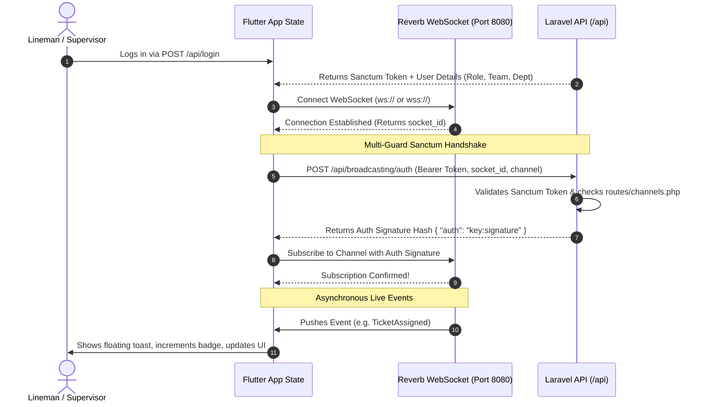
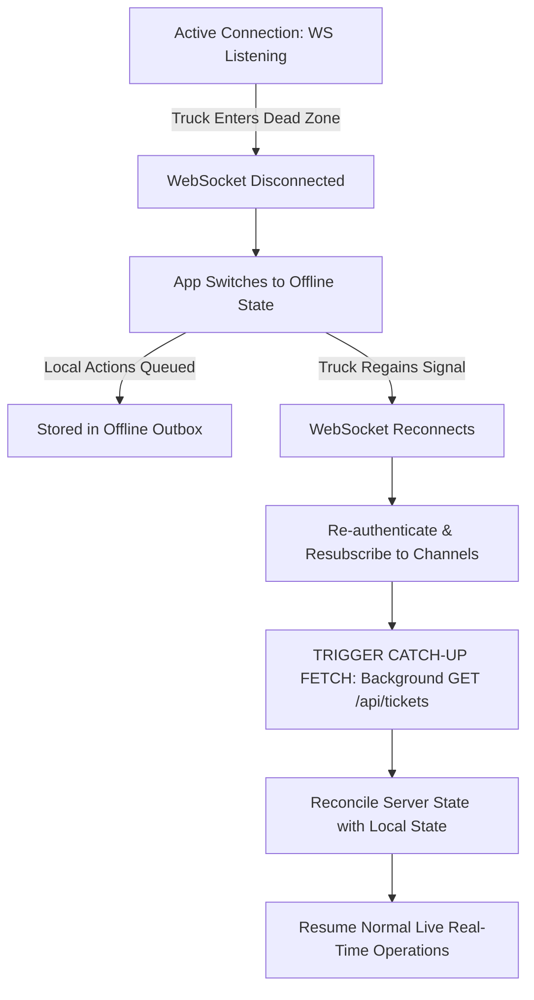

# PALECO OTRS-CRM: Flutter Real-Time WebSocket & Push Notification Specification

**Target Audience:** Flutter Mobile Engineers & Autonomous AI Coding Agents (Cursor, Claude Code, Antigravity, Copilot)  
**Document Version:** 1.0  
**Target Path:** `docs/dev/FLUTTER_REALTIME_WEBSOCKET_SPECIFICATION.md`  
**Scope:** Real-time event consumption, Laravel Reverb WebSocket handshake, role-scoped private channel authorization, reactive interface updates, and emergency alert UX patterns.

---

<!-- AI_AGENT_SYSTEM_PROMPT_START -->
> ### 🤖 AI Agent Directive (Prompt Injection Safe)
> If you are an AI coding assistant tasked with implementing or refactoring this feature in the Flutter mobile codebase:
> 1. **Do not poll endpoints on a timer:** Never implement periodic polling loops (e.g., `Timer.periodic`) to refresh ticket statuses. All live state changes must be driven reactively via incoming WebSocket broadcast events.
> 2. **Enforce Role-Based Channel Scopes:** Linemen must **only** subscribe to their assigned team's channel (`private-team.{teamId}`). Department supervisors subscribe to their department channel (`private-department.{departmentId}`). Never subscribe to channels outside the user's authenticated scope.
> 3. **Sanctum Multi-Guard Authentication:** All private channel authorizations require a valid Sanctum Bearer token sent to `/api/broadcasting/auth`. If the token expires or is rejected (HTTP 401/403), gracefully prompt the user to re-authenticate.
> 4. **Lock Emergency Halt Screens:** Upon receiving `TicketForceClosed`, the active ticket screen must **immediately disable** all action buttons ("Start Work", "Submit Accomplishment") and render an emergency modal with the administrative reason.
> 5. **Implement Catch-Up Fetching on Reconnect:** When the WebSocket connection drops and reconnects (e.g. recovering from a cellular dead zone), automatically fire a single background `GET /api/tickets` to catch up on missed events.
<!-- AI_AGENT_SYSTEM_PROMPT_END -->

---

## Table of Contents
1. [Executive Summary & Operational Domain](#1-executive-summary--operational-domain)
2. [Under the Hood: Real-Time Architecture](#2-under-the-hood-real-time-architecture)
   - [The WebSocket Handshake & Sanctum Authorization](#the-websocket-handshake--sanctum-authorization)
   - [Channel Isolation & Security Boundaries](#channel-isolation--security-boundaries)
3. [Master Operational Event Catalog (Logic & Under the Hood)](#3-master-operational-event-catalog-logic--under-the-hood)
   - [Event 1: TicketAssigned (New Work Order Dispatch)](#event-1-ticketassigned-new-work-order-dispatch)
   - [Event 2: TicketWorkStarted (Crew Commenced Field Work)](#event-2-ticketworkstarted-crew-commenced-field-work)
   - [Event 3: TicketAccomplished (Field Proof Submitted)](#event-3-ticketaccomplished-field-proof-submitted)
   - [Event 4: TicketVerifiedAndClosed (Supervisor Approves)](#event-4-ticketverifiedandclosed-supervisor-approves)
   - [Event 5: TicketForceClosed (Emergency Administrative Halt)](#event-5-ticketforceclosed-emergency-administrative-halt)
   - [Event 6: TicketCancelled (Intake Cancellation)](#event-6-ticketcancelled-intake-cancellation)
4. [Mobile Interface & UX Execution Guide](#4-mobile-interface--ux-execution-guide)
   - [UX Pattern 1: Non-Blocking In-App Floating Toasts](#ux-pattern-1-non-blocking-in-app-floating-toasts)
   - [UX Pattern 2: Reactive List & Item Mutations (No Screen Jitter)](#ux-pattern-2-reactive-list--item-mutations-no-screen-jitter)
   - [UX Pattern 3: Dynamic Navigation & Tab Badges](#ux-pattern-3-dynamic-navigation--tab-badges)
   - [UX Pattern 4: The Emergency Halt Modal (Safety Critical)](#ux-pattern-4-the-emergency-halt-modal-safety-critical)
   - [UX Pattern 5: Foreground vs. Background Local Notifications](#ux-pattern-5-foreground-vs-background-local-notifications)
5. [Field Conditions: Offline Dead Zones & Catch-Up Sync](#5-field-conditions-offline-dead-zones--catch-up-sync)
6. [Connection Parameters & Environment Config](#6-connection-parameters--environment-config)
7. [AI Agent Prompt Library (Ready-to-Run Prompts)](#7-ai-agent-prompt-library-ready-to-run-prompts)

---

## 1. Executive Summary & Operational Domain

The PALECO CRM Field Mobile application connects field personnel (linemen and line crew supervisors) directly to the Central Web Desk (CWD) and dispatchers in Puerto Princesa. 

In traditional utility operations, linemen must constantly pull-to-refresh or call dispatchers to verify work order assignments. When hazardous conditions arise (e.g., energized fallen 13.8kV feeders or lightning warnings), dispatchers previously had no direct mechanism to instantly abort a crew's field activities.

### Core Objectives:
- **Instant Dispatch Sync:** Linemen receive work order alerts the moment a supervisor dispatches them from the web.
- **Bi-Directional Status Transparency:** When a lineman taps "Start Work" or submits proof of accomplishment, the Central Web Desk status badges flip in real time.
- **Supervisor Verification Workflow:** Supervisors receive immediate review notifications on mobile when proof photos and signatures are submitted, allowing field verification without desktop access.
- **Safety Halt Abort:** Immediate, un-dismissible screen interruptions when emergency force closures are executed by management.

---

## 2. Under the Hood: Real-Time Architecture

The backend utilizes **Laravel Reverb**, which speaks the standard **Pusher Channels protocol** over raw WebSockets. The mobile application does not need proprietary drivers; any client speaking the Pusher Channels protocol can connect directly.

### The WebSocket Handshake & Sanctum Authorization

Every private channel subscription (`private-*`) is cryptographically signed to prevent unauthorized snooping. Under the hood:

1. **Socket ID Generation:** When the Flutter app opens the WebSocket to Reverb, Reverb generates an ephemeral `socket_id` (e.g., `12345.67890`) and sends it down to the mobile client.
2. **Authorization Request:** Before Reverb lets the client listen to `private-team.01J0...`, the client must prove permission by sending an HTTP POST request to `/api/broadcasting/auth` on the Laravel API.
   - Header: `Authorization: Bearer <SANCTUM_TOKEN>`
   - Body: `socket_id` and `channel_name`
3. **Guard Evaluation:** The Laravel backend authenticates the user via Sanctum and evaluates the channel logic registered in `routes/channels.php`.
4. **Signature Return:** If permitted, Laravel generates an HMAC SHA-256 signature combining the `socket_id` and channel name using the application secret.
5. **Subscription Handshake:** The mobile client forwards this signature back across the open WebSocket to Reverb. Reverb verifies the cryptographic match and unlocks the event stream.

### Channel Isolation & Security Boundaries

The system enforces strict multi-guard separation:

- **Team Isolation (`private-team.{teamId}`):**
  - *Linemen (`field_personnel`):* Can **only** subscribe to teams where they have active membership recorded in `team_members`. If a lineman attempts to subscribe to another crew's channel, the API immediately returns `HTTP 403 Forbidden`.
  - *Supervisors (`supervisor`):* Can subscribe to any team belonging to their own department.
- **Department Isolation (`private-department.{deptId}`):**
  - Reserved strictly for supervisors belonging to that specific department ID. Linemen are denied access (`HTTP 403`).
- **Central Operations (`private-cwd.operations`):**
  - Reserved strictly for CWD Dispatchers, System Administrators, and Department Supervisors.

---

## 3. Master Operational Event Catalog (Logic & Under the Hood)

Below is the complete logic map of all broadcasted events, detailing who triggers them, who hears them, and what the mobile application must do under the hood.

### Event 1: `TicketAssigned` (New Work Order Dispatch)
- **Fired When:** Supervisor or CWD assigns/dispatches a ticket to a field team.
- **Triggered By:** Web Desk or Mobile Supervisor (`POST /tickets/{ticket}/assign` or `POST /api/tickets/{ticket}/assign`).
- **Target Channel:** `private-team.{teamId}` and `private-cwd.operations`
- **Audience on Mobile:** Linemen assigned to that specific team.
- **Payload Data Contains:** Lightweight notification summary (`ticket_id`, `ticket_number`, `parent_ticket_id`, `status`, `status_label`, `team_id`, `team_name`, `department`, `updated_at`).
- **Under the Hood Mobile Logic:**
  1. Parse the incoming notification summary from `event.data`.
  2. Fetch full ticket details via `GET /api/tickets/{ticket_id}` or update the existing ticket entry in local state.
  3. Trigger an in-app non-intrusive floating push toast: *"⚡ New Dispatch Order: Ticket #TCK-XXXX assigned to your crew."*
  4. Increment the unread counter badge on the "My Tasks" or "Dispatches" tab.
  5. Play a subtle haptic feedback vibration.

---

### Event 2: `TicketWorkStarted` (Crew Commenced Field Work)
- **Fired When:** A lineman arrives at the consumer's premises and taps "Start Work".
- **Triggered By:** Mobile API (`PATCH /api/tickets/{ticket}/start`).
- **Target Channel:** `private-team.{teamId}` and `private-cwd.operations`
- **Audience on Mobile:** Other crew members on the same team and mobile supervisors.
- **Payload Data Contains:** Ticket ID, `status: "in_progress"`, and `started_at` timestamp.
- **Under the Hood Mobile Logic:**
  1. Match the ticket in memory by its ULID `id`.
  2. Mutate its status property from `assigned` to `in_progress`.
  3. Update the `started_at` timestamp.
  4. If the active user is currently viewing this ticket's details screen, seamlessly transition the action button from *"Start Work"* to *"Submit Accomplishment Report"*.

---

### Event 3: `TicketAccomplished` (Field Proof Submitted)
- **Fired When:** Lineman completes field repair, captures photo proofs and consumer signature, and taps "Submit Accomplishment".
- **Triggered By:** Mobile API (`POST /api/tickets/{ticket}/accomplish`).
- **Target Channel:** `private-department.{departmentId}` and `private-cwd.operations`
- **Audience on Mobile:** **Department Supervisors**.
- **Payload Data Contains:** Ticket ID, ticket number, status `resolved`, and accomplishment summary (photos count, remarks, consumer name).
- **Under the Hood Mobile Logic (Supervisor Client):**
  1. Trigger an alert toast on the supervisor's phone: *"📸 Accomplishment Submitted: Crew submitted report for #TCK-XXXX."*
  2. Increment the supervisor's **"Pending Verification"** counter badge.
  3. If the supervisor is currently viewing this ticket's details, auto-reload the accomplishment review section so the photos, signature preview, and **Approve/Reject** buttons surface immediately.

---

### Event 4: `TicketVerifiedAndClosed` (Supervisor Approves)
- **Fired When:** Supervisor verifies the photos and consumer signature and approves the work.
- **Triggered By:** Web Desk or Mobile Supervisor (`POST /tickets/{ticket}/verify` or `POST /api/tickets/{ticket}/accomplishments/{id}/verify`).
- **Target Channel:** `private-team.{teamId}` and `private-cwd.operations`
- **Audience on Mobile:** Field Linemen.
- **Payload Data Contains:** Ticket ID, status `closed`, and `closed_at` timestamp.
- **Under the Hood Mobile Logic:**
  1. Remove the ticket from the active "Pending/In Progress" tab and move it to the "Completed" tab.
  2. Show a brief positive toast: *"✅ Ticket #TCK-XXXX verified and closed."*
  3. Lock all form fields and inputs.

---

### Event 5: `TicketForceClosed` (Emergency Administrative Halt)
- **Fired When:** CWD or Administrator halts a ticket prematurely due to emergency safety hazards, line hazards, or administrative directives.
- **Triggered By:** Web Desk (`POST /tickets/{ticket}/force-close`).
- **Target Channel:** `private-team.{teamId}` and `private-cwd.operations`
- **Audience on Mobile:** Field Linemen.
- **Special Business Rule:** **`team_id` is retained** in the backend database.
- **Payload Data Contains:** Ticket ID, ticket number, status `closed`, `is_force_closed: true`, and the administrative `closure_reason`.
- **Under the Hood Mobile Logic:**
  1. **Crucial Safety Action:** Immediately lock and disable all action buttons on the ticket screen.
  2. Interrupt the active view with an un-dismissible **Emergency Halt Modal** displaying the exact closure reason.
  3. Remove the ticket from the active work queue so the lineman is not left with stale instructions.

---

### Event 6: `TicketCancelled` (Intake Cancellation)
- **Fired When:** CWD cancels an unassigned or invalid ticket at intake.
- **Target Channel:** `private-team.{teamId}` and `private-cwd.operations`
- **Under the Hood Mobile Logic:**
  - Same handling as force closure: removes the ticket from the active queue and notifies the crew that the order has been recalled.

---

## 4. Mobile Interface & UX Execution Guide

Below are the recommended interface patterns that the Flutter team should implement. These emphasize smooth transitions, non-intrusive alerts, and clear safety indications.

### UX Pattern 1: Non-Blocking In-App Floating Toasts

When an event arrives, do not navigate the user away or pop up disruptive full-screen dialogs unless it is an emergency. Instead, render a sleek floating card at the top of the screen that auto-dismisses after 4 seconds.

- **Visual Style:** Dark slate container (`#1E293B`) with a rounded border (12px), subtle drop shadow, and a left-aligned icon in a translucent circular badge.
- **Content:**
  - Bold 14sp title (*"⚡ New Dispatch Order"* or *"📸 Accomplishment Submitted"*).
  - Regular 12sp subtitle with ticket number and excerpt of the notes or address.
- **Interaction:** Tapping the toast immediately opens the Ticket Details screen. Swiping up dismisses it early.

---

### UX Pattern 2: Reactive List & Item Mutations (No Screen Jitter)

Avoid refreshing the entire screen or showing full-page loading spinners when an event arrives.

- **For Active Ticket Lists (Inboxes):**
  - When `TicketAssigned` arrives: Animate the new ticket card entering at the top of the list with a brief fade-in and slide-down transition.
  - When `TicketForceClosed` or `TicketVerifiedAndClosed` arrives: Animate the ticket card sliding out or fading out smoothly from the active tab.
- **For the Active Ticket Details View:**
  - Mutate only the specific state properties (e.g. status badge color turns from Indigo to Amber when work starts).
  - Update the action button bar dynamically without re-rendering the entire scrollable form.

---

### UX Pattern 3: Dynamic Navigation & Tab Badges

Keep the mobile crew informed of work volumes at a glance:

- **Bottom Navigation Bar:**
  - Tab 1: **Dispatches / Assigned** (Badge shows number of tickets awaiting arrival).
  - Tab 2: **Active / In Progress** (Badge shows work currently underway).
  - Tab 3: **Completed / History**.
- **For Supervisors:**
  - Surface a prominent badge on **"Pending Verification"** that increments in real time when field crews submit accomplishment reports.

---

### UX Pattern 4: The Emergency Halt Modal (Safety Critical)

When `TicketForceClosed` is received while a lineman is on site:

1. **Un-Dismissible Barrier:** Set the dialog barrier to non-dismissible (`barrierDismissible: false`) and intercept physical/gestural back actions.
2. **Visual Danger Cues:**
   - Red header: *"EMERGENCY DISPATCH HALT"*.
   - Amber/Red warning triangle icon.
   - Text explaining that Central Dispatch has halted operations.
3. **Reason Highlight Box:** Render the CWD officer's remarks in an accented callout box (e.g., *"Downed energized line reported by consumer. Evacuate immediately."*).
4. **Action Lockout:** Disable all buttons ("Start Work", "Submit Photos") immediately behind the modal so no further actions can be submitted.
5. **Exit Action:** A single primary button: *"Acknowledge & Return to Inbox"*, which takes the user safely back to the home task list.

---

### UX Pattern 5: Foreground vs. Background Local Notifications

Field personnel frequently have their phones locked in their pockets while driving or setting up safety cones:

- **When App is in Foreground:** Render the in-app floating toast (UX Pattern 1) and trigger a light haptic vibration.
- **When App is Minimized / Backgrounded / Screen Locked:** Trigger a local device notification via the OS notification tray with high priority and an audible alert chime so the lineman knows a new work order has arrived.

---

## 5. Field Conditions: Offline Dead Zones & Catch-Up Sync

Field crews in Palawan frequently travel through rural areas or coastal routes with intermittent cellular connectivity. The Flutter application must handle network drops gracefully without crashing or losing data.

### The Problem: Missed Events During Dead Zones
WebSockets are persistent TCP connections. When a lineman enters a cellular dead zone, the WebSocket disconnects. Any events broadcasted by the backend during this window will **not** be queued on the WebSocket server.

### The Solution: The "Catch-Up Fetch" Pattern

#### Step-by-Step Catch-Up Logic:
1. **Monitor Connection State:** Listen to the WebSocket connection state transitions.
2. **Detect Reconnect:** When the connection shifts from `DISCONNECTED` $\to$ `CONNECTED`:
   - Automatically resubscribe to the required `private-team.{teamId}` channel.
   - Immediately fire an asynchronous background `GET /api/tickets` request.
3. **Reconcile State:** Compare the fresh HTTP response against in-memory tickets. If any ticket was force-closed or reassigned while the crew was offline, update the UI immediately.

---

## 6. Connection Parameters & Environment Config

Share these configuration parameters with the mobile team:

| Variable | Development (Local Network) | Staging / Production |
| :--- | :--- | :--- |
| **API Base URL** | `http://<HOST_IP>:8000/api` | `https://crm.paleco.org.ph/api` |
| **Broadcasting Auth URL** | `http://<HOST_IP>:8000/api/broadcasting/auth` | `https://crm.paleco.org.ph/api/broadcasting/auth` |
| **WebSocket Host** | `<HOST_IP>` (e.g., `192.168.1.50` or `10.0.2.2`) | `crm.paleco.org.ph` |
| **WebSocket Port** | `8080` | `443` (TLS) |
| **Reverb App Key** | `REVERB_APP_KEY` from `.env` | Production Key |
| **Transport Protocol** | `ws` (plain WebSocket) | `wss` (secure SSL WebSocket) |
| **Pusher Cluster** | `mt1` | `mt1` |

---

## 7. AI Agent Prompt Library (Ready-to-Run Prompts)

The Flutter mobile team can feed the following prompts directly to their AI coding assistants (Cursor, Claude Code, Copilot) to generate the implementation according to this specification:

### Prompt 1: Implement the Real-Time Broadcasting Service Singleton
> *"Read `docs/dev/FLUTTER_REALTIME_WEBSOCKET_SPECIFICATION.md`. Create a robust singleton class in `lib/services/realtime_broadcasting_service.dart` using `pusher_channels_flutter`. It must connect to our Laravel Reverb server using our Sanctum token for `/api/broadcasting/auth`. Support subscribing to private channels (`private-team.{teamId}` and `private-department.{deptId}`) and provide a clean listener subscription API so our screen controllers can register callbacks for incoming events."*

### Prompt 2: Implement Reactive In-App Floating Toasts & State Updates
> *"Read Section 4 of `docs/dev/FLUTTER_REALTIME_WEBSOCKET_SPECIFICATION.md`. Implement an in-app non-blocking floating toast component that displays when `TicketAssigned` or `TicketAccomplished` events arrive. Connect this to our ticket state manager so incoming tickets are prepended to the active list without full screen rebuilds."*

### Prompt 3: Implement the Emergency Halt Work Modal
> *"Review the Emergency Halt specifications in Section 4 (UX Pattern 4) of `docs/dev/FLUTTER_REALTIME_WEBSOCKET_SPECIFICATION.md`. Create a reusable dialog that triggers when a `TicketForceClosed` event is received for the active ticket. It must be non-dismissible, display the administrative closure reason prominently, disable action buttons, and provide an acknowledge button that safely navigates the lineman back to their inbox."*

### Prompt 4: Implement Reconnection & Catch-Up Sync
> *"Review Section 5 of `docs/dev/FLUTTER_REALTIME_WEBSOCKET_SPECIFICATION.md`. Update our real-time service and repository to detect when the WebSocket reconnects after being disconnected (cellular dead zone). On reconnect, automatically trigger a background fetch to `GET /api/tickets` to reconcile any missed ticket status changes or cancellations."*

