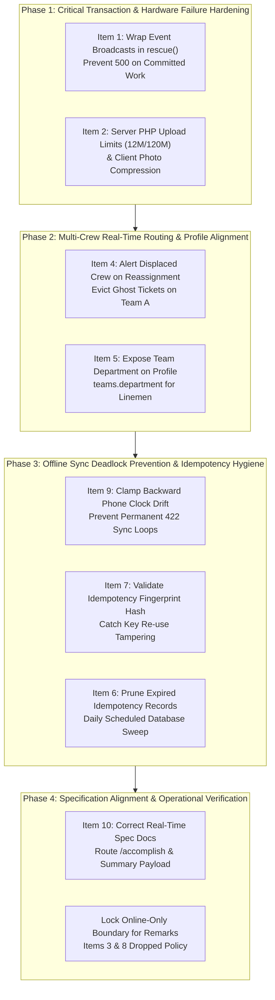

# PALECO OTRS-CRM: Mobile Integration Remediation Plan & Phased Workflow

**Target Audience:** Central Web Desk (Backend) Engineers, Flutter Mobile Engineers, DevOps  
**Document Version:** 1.0  
**Target Path:** `docs/dev/MOBILE_INTEGRATION_REMEDIATION_PLAN_AND_PHASED_WORKFLOW.md`  
**Reference Commit:** `228f8fb` (Mobile Review Audit)

---

## 1. Executive Summary & Policy Decisions

Following the Flutter mobile team's review of the backend integration, this document establishes the official **phased remediation workflow** to address the feedback.

### Key Policy Decision: Items 3 & 8 Dropped (Notes / Remarks Are Online-Only)
> [!IMPORTANT]
> **Items 3 and 8 are officially dropped.**
> 
> In the PALECO system architecture, **Offline-Asynchronous store-and-forward queueing applies strictly and exclusively to:**
> 1. **Starting work:** `PATCH /api/v1/tickets/{ticket}/start`
> 2. **Submitting accomplishments:** `POST /api/v1/tickets/{ticket}/accomplish`
>
> **Ticket Remarks (`POST /api/v1/tickets/{ticket}/remarks`) are live, online-only communications.**
> - Remarks will **not** use the `idempotent` middleware.
> - Remarks will **not** accept or process offline client timestamps.
> - The mobile application team must **remove remarks from the offline outbox queue**. When a lineman's device is in a cellular dead zone, the remarks UI must disable the submit button and show a clear indicator: *"An active internet connection is required to post remarks."*

With Items 3 and 8 dropped, the remaining **8 concerns** are organized into **four structured, progressive implementation phases**.

---

## 2. Master Phased Workflow Map



---

## 3. Phase-by-Phase Technical Specifications

### Phase 1: Critical Transaction & Hardware Failure Hardening (High Priority)

**Objective:** Ensure that completed lineman field actions can never crash or fail due to network hiccups with the Reverb WebSocket daemon, and that photo evidence uploads are never dropped at the PHP server boundary.

#### Phase 1.1: Event Broadcast `rescue()` Protection (Item 1)
- **Problem:** `TicketWorkStarted`, `TicketAccomplished`, and `TicketAssigned` implement `ShouldBroadcastNow`. If the Reverb server is temporarily restarting or unreachable, the broadcast raises an unhandled exception inside `DB::afterCommit`. Even though the database transaction committed successfully, the HTTP request crashes with an HTTP 500 error, causing repeated retries against already-resolved tickets.
- **Remediation:**
  1. In [`app/Services/Tickets/TicketService.php`](file:///c:/Users/allen/Desktop/Capstone/-NEW-CRM-PALECO/PALECO_OTRS-CRM/app/Services/Tickets/TicketService.php) and [`app/Services/Tickets/TicketAccomplishmentService.php`](file:///c:/Users/allen/Desktop/Capstone/-NEW-CRM-PALECO/PALECO_OTRS-CRM/app/Services/Tickets/TicketAccomplishmentService.php), wrap all `dispatch()` calls inside `DB::afterCommit` with Laravel's `rescue()` helper:
     ```php
     DB::afterCommit(function () use ($freshTicket) {
         rescue(fn () => TicketWorkStarted::dispatch($freshTicket), report: true);
     });
     ```
  2. A failure in the live notification stream will be logged in `storage/logs/laravel.log` without failing the HTTP response. Linemen receive HTTP 200/201 and their sync worker records completion.

#### Phase 1.2: Server PHP Upload Limits & Photo Handling (Item 2)
- **Problem:** `SubmitAccomplishmentReportRequest` allows up to 10 photos of 10 MB each plus a 5 MB signature (~105 MB). Default `upload_max_filesize = 2M` and `post_max_size = 8M` silently drop the entire request, returning confusing 422 errors.
- **Remediation:**
  1. **Server Configuration (`php.ini`):**
     ```ini
     upload_max_filesize = 12M
     post_max_size = 120M
     max_file_uploads = 20
     max_execution_time = 180
     max_input_time = 180
     ```
  2. **Nginx Reverse Proxy (`nginx.conf`):**
     ```nginx
     client_max_body_size 120M;
     ```
  3. **Mobile Client Recommendation:** The Flutter mobile app should resize camera photos to 1920x1080 JPEG at 80% quality before queuing for upload. This brings average photo size down to 400KB–800KB, allowing an entire 10-photo report to upload in <6 MB.

---

### Phase 2: Multi-Crew Real-Time Routing, Profile Alignment & Reassignment Policy (Completed)

**Objective:** Prevent ghost tickets on reassigned crews, enforce strict operational lifecycle policies for ticket assignment/reassignment, update the mobile simulator UI, and ensure field personnel profiles display their team's department.

#### Phase 2.1: Multi-Crew Reassignment Notification & Policy Enforcement (Item 4)
- **Problem:** When a ticket was reassigned from Team A to Team B, `TicketAssigned` broadcasted only to `private-team.{$ticket->team_id}` (Team B). Team A's mobile phones never received any event and kept the ticket on their screens, risking duplicate work. Furthermore, reassignment was previously unconstrained, allowing illegal state mutations such as reassigning tickets that were already in progress.
- **Strict Reassignment Policy Implementation:**
  1. **Status Guards:** Initial assignment is restricted strictly to `OPEN` tickets. Ticket reassignment is restricted strictly to `ASSIGNED` tickets.
  2. **In-Progress Guard:** Tickets in `IN_PROGRESS` status can **never** be reassigned. Once a crew begins work on site, reassignment is locked to prevent operational disruption and race conditions. Attempting to reassign returns `HTTP 422 Unprocessable Content`.
  3. **Policy Gate:** Added `TicketPolicy::assign()` guard restricting assignment/reassignment to open and assigned statuses.
- **Dual WebSocket Broadcast Implementation:**
  1. In [`app/Events/TicketAssigned.php`](file:///c:/Users/allen/Desktop/Capstone/-NEW-CRM-PALECO/PALECO_OTRS-CRM/app/Events/TicketAssigned.php):
     - Added `public ?string $previousTeamId = null` to the constructor.
     - In `broadcastOn()`, when `$this->previousTeamId && $this->previousTeamId !== $this->ticket->team_id`, broadcasts to both `private-team.{$this->ticket->team_id}` AND `private-team.{$this->previousTeamId}`.
     - In `broadcastWith()`, exposed `'previous_team_id' => $this->previousTeamId`.
  2. In [`app/Services/Tickets/TicketService.php`](file:///c:/Users/allen/Desktop/Capstone/-NEW-CRM-PALECO/PALECO_OTRS-CRM/app/Services/Tickets/TicketService.php):
     - Captured `$previousTeamId = $lockedTicket->team_id;` before the database update.
     - Dispatched `TicketAssigned::dispatch($freshTicket, $previousTeamId);`.
- **Mobile Simulator UI Enhancements:**
  1. Replaced single static button with dynamic "Assign Crew" (for `open` tickets) and "Reassign Crew" (for `assigned` tickets).
  2. For `in_progress`, `resolved`, or `closed` tickets, assignment/reassignment buttons are completely hidden.
  3. Reassignment modal header explicitly displays "Reassign Crew", disables the currently assigned team in the dropdown, and enforces mandatory reason input.

#### Phase 2.2: Field Personnel Department Profile Mapping (Item 5)
- **Problem:** Linemen have `users.department_id = null` because their department is determined by their operational team (`teams.department_id`). `GET /api/v1/user/profile` returned `"department": null`, and the teams array lacked department metadata.
- **Remediation:**
  1. In [`app/Services/Users/ProfileService.php`](file:///c:/Users/allen/Desktop/Capstone/-NEW-CRM-PALECO/PALECO_OTRS-CRM/app/Services/Users/ProfileService.php) and [`app/Services/Auth/MobileAuthService.php`](file:///c:/Users/allen/Desktop/Capstone/-NEW-CRM-PALECO/PALECO_OTRS-CRM/app/Services/Auth/MobileAuthService.php):
     - Eager-loaded `teams.department`.
  2. In [`app/Http/Resources/Api/UserResource.php`](file:///c:/Users/allen/Desktop/Capstone/-NEW-CRM-PALECO/PALECO_OTRS-CRM/app/Http/Resources/Api/UserResource.php):
     - Inside `teams[]`: exposed `'department_id' => $team->department_id` and `'department' => $team->department?->name`.
     - Root profile fallback: if `$this->department_id` is null, falls back to `$this->teams->first()?->department_id` and team department name.

---

### Phase 3: Offline Sync Deadlock Prevention & Idempotency Hygiene (Completed)

**Objective:** Eliminate permanent sync deadlocks caused by device clock skew, enforce lifecycle chronological order, protect idempotency keys from payload tampering, and automate database cleanup.

#### Phase 3.1: Lifecycle-Aware Clock Drift Clamping (Item 9)
- **Problem:** If a lineman's phone clock is behind the server clock, the recorded client timestamp could precede earlier lifecycle milestones. A naive timestamp check might fail with HTTP 422, deadlocking an immutable offline outbox queue.
- **Remediation:**
  1. In [`app/Http/Controllers/Api/Concerns/ResolvesClientTimestamp.php`](file:///c:/Users/allen/Desktop/Capstone/-NEW-CRM-PALECO/PALECO_OTRS-CRM/app/Http/Controllers/Api/Concerns/ResolvesClientTimestamp.php):
     - Validated that client timestamps strictly cannot precede ticket creation (`reported_at` or `created_at`).
     - Implemented **Lifecycle-Aware Clamping**:
       - When starting work (`/start` on an `assigned` ticket): If the client timestamp is earlier than the assignment timestamp (`activeAssignment->created_at`), it is clamped forward to `assigned_at`, guaranteeing that `started_at >= assigned_at`.
       - When accomplishing work (`/accomplish` on an `in_progress` ticket): If the client timestamp is earlier than `started_at`, it is clamped forward to `started_at`, guaranteeing that `resolved_at >= started_at`.
     - If client timestamp exceeds +5 minutes into the future, it is clamped to `now()`.
  2. This guarantees mathematical lifecycle chronology: $\text{created\_at} \le \text{assigned\_at} \le \text{started\_at} \le \text{resolved\_at}$.

#### Phase 3.2: Idempotency Key Request Fingerprint Validation (Item 7)
- **Problem:** `HandleIdempotency` saves a `request_hash`, but if a key is reused with a completely different endpoint or payload, the middleware replays the old response before checking the hash.
- **Remediation:**
  1. In [`app/Http/Middleware/HandleIdempotency.php`](file:///c:/Users/allen/Desktop/Capstone/-NEW-CRM-PALECO/PALECO_OTRS-CRM/app/Http/Middleware/HandleIdempotency.php):
     - Calculate `$requestHash` at the top of the middleware.
     - If `$record` exists and `$record->request_hash !== $requestHash`, return HTTP 422:
     ```php
     return response()->json([
         'success' => false,
         'message' => 'Idempotency key has already been used with a different request payload.',
     ], Response::HTTP_UNPROCESSABLE_ENTITY);
     ```

#### Phase 3.3: Idempotency Record Table Pruning (Item 6)
- **Problem:** `idempotency_records` stores responses with an expiration of 7 days, but no cleanup job deletes expired rows.
- **Remediation:**
  1. Add `use Illuminate\Database\Eloquent\Prunable;` to [`app/Models/IdempotencyRecord.php`](file:///c:/Users/allen/Desktop/Capstone/-NEW-CRM-PALECO/PALECO_OTRS-CRM/app/Models/IdempotencyRecord.php):
     ```php
     public function prunable()
     {
         return static::where('expires_at', '<', now());
     }
     ```
  2. In [`routes/console.php`](file:///c:/Users/allen/Desktop/Capstone/-NEW-CRM-PALECO/PALECO_OTRS-CRM/routes/console.php), schedule daily model pruning:
     ```php
     Schedule::command('model:prune', ['--model' => [IdempotencyRecord::class]])->daily();
     ```
  3. In `HandleIdempotency.php`, add `->where('expires_at', '>', now())` to the active key lookup.

---

### Phase 4: Specification Alignment & Scope Boundaries (Documentation)

**Objective:** Synchronize all developer reference guides with reality and establish firm operational boundaries.

#### Phase 4.1: Documentation Typo & Payload Corrections (Item 10)
- **Corrections applied in [`docs/dev/FLUTTER_REALTIME_WEBSOCKET_SPECIFICATION.md`](file:///c:/Users/allen/Desktop/Capstone/-NEW-CRM-PALECO/docs/dev/FLUTTER_REALTIME_WEBSOCKET_SPECIFICATION.md):**
  - Accomplishment submission endpoint corrected to `POST /api/v1/tickets/{ticket}/accomplish`.
  - `TicketAssigned` payload documented as a lightweight notification summary (`ticket_id`, `ticket_number`, `parent_ticket_id`, `status`, `status_label`, `team_id`, `team_name`, `department`, `updated_at`). Upon receipt, the mobile app refreshes ticket details via `GET /api/v1/tickets/{ticket}`.

#### Phase 4.2: Scope Boundary Clarification (Dropped Items 3 & 8)
- **Documented in [`docs/dev/FLUTTER_OFFLINE_SYNC_IMPLEMENTATION_SPEC.md`](file:///c:/Users/allen/Desktop/Capstone/-NEW-CRM-PALECO/docs/dev/FLUTTER_OFFLINE_SYNC_IMPLEMENTATION_SPEC.md):**
  - Offline-asynchronous store-and-forward queueing applies strictly to `/start` and `/accomplish`.
  - Remarks (`/remarks`) require an active internet connection.
  - Mobile UI guideline: grey out remark submission when offline with tooltip: *"An active internet connection is required to post remarks."*

---

## 4. Operational Checklist & Verification Matrix

| Phase | Tasks / Items | Verification Method | Pass Criteria |
| :--- | :--- | :--- | :--- |
| **Phase 1** | Items 1 & 2 (Broadcast rescue & Upload limits) | Kill Reverb daemon, call `/start` and `/accomplish`. Upload 10-photo batch. | HTTP 200/201 returned; no 500 error; DB commits safely; photos persist. |
| **Phase 2** | Items 4 & 5 (Reassignment channel, Reassignment Policy & Department profile) | Reassign ticket from Team 1 to Team 2. Attempt reassignment on in-progress ticket. Call `GET /api/v1/user/profile` as lineman. | Event sent on both `team.1` and `team.2`. In-progress reassignment blocked with 422. Profile includes `teams[].department` and root fallback. |
| **Phase 3** | Items 6, 7, 9 (Lifecycle clock drift, hash check, pruning) | Send action with client timestamp before assignment/start. Send same key with different body. Run `model:prune`. | Action clamped to assignment/start milestone (HTTP 200); hash mismatch returns 422; expired records pruned. |
| **Phase 4** | Item 10 & Dropped Items 3/8 policy | Inspect `FLUTTER_REALTIME_WEBSOCKET_SPECIFICATION.md` and `FLUTTER_OFFLINE_SYNC_IMPLEMENTATION_SPEC.md`. | Routes match `routes/api.php`; remarks confirmed online-only. |

