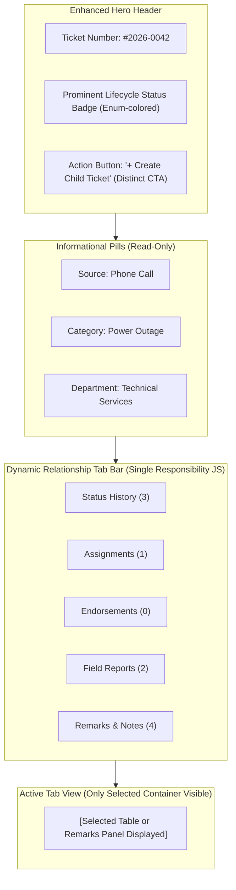
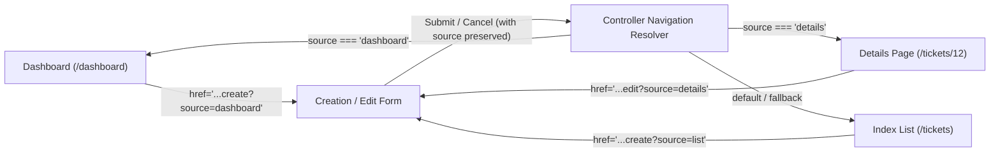
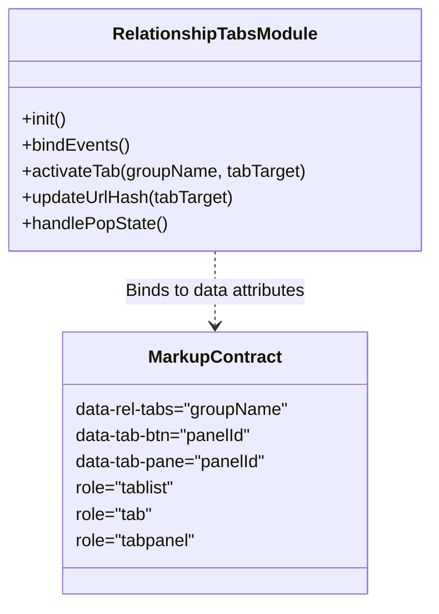
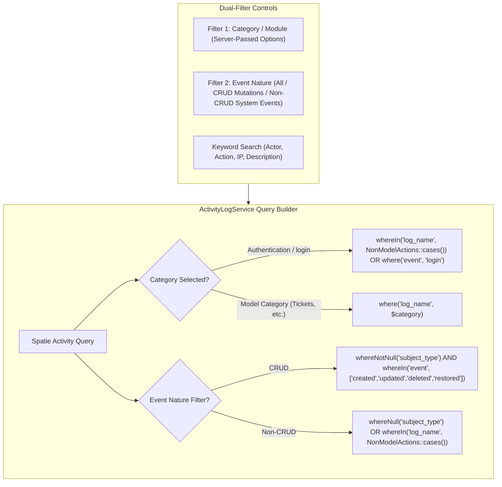

# PALECO OTRS-CRM: Architectural Cleanup & Web Refactor Implementation Plan (Part 2)

**Document Target:** `docs/misc/SYSTEM_CLEANUP_AND_IMPROVEMENT_PHASES_PART_2.md`  
**Document Version:** 1.0  
**Context:** Technical analysis, architectural critique, UI/UX specification, and execution blueprint for Part 2 Web Refactoring and Realized Features across 5 isolated phases.  
**Execution Strategy:** 5 isolated phases corresponding to **5 atomic Git commits** (commits executed strictly by user).  
**Constraint Enforcement:** **NO APPLICATION CODE COMMITTED OR IMPLEMENTED IN ADVANCE**. Architectural documentation and planning only.

---

## Executive Summary & Unfiltered Overview

Part 2 of the PALECO OTRS-CRM system hardening focuses on Web UX clarity, design consistency, smart navigation awareness, relationship visibility control, and activity log audit accuracy. 

The previous Part 1 addressed core backend contracts, unified query scopes, policy hardening (anti-enumeration 404s), universal error page handling, mobile profile team hydration, and dual-layer rate limiting with virtual cache lockout. Part 2 shifts focus to the user-facing web tier, addressing operational friction points identified in active CWD and Admin workflows.

| Phase | Concern / Scope | Primary Impact Surface | Architecture & Commit Scope |
| :---: | :--- | :--- | :--- |
| **Phase 1** | Ticket Details UX & Department Filtering | `TicketDetails.blade.php`, `Ticket.php`, `TicketService.php`, `TicketTable.php` | Dynamic relationship tabs, polished remarks form, unassigned team empty state fix, child ticket button distinction, prominent ticket lifecycle badge, and server-passed department filtering. |
| **Phase 2** | Uniformity of Status & Enum Pills | `app/Enums/*`, `DashboardOverview.blade.php`, `ticket-table.blade.php`, CSS & JS charts | Centralize Tailwind badge classes, hex codes, and chart colors directly on PHP Enums; eliminate duplicate ad-hoc styling across blade templates and stylesheets. |
| **Phase 3** | Smart Navigation & Return Awareness | Web Controllers (`TicketController`, `UserController`, `TeamController`, `DepartmentController`), Views | Standardize `source` query parameter across multi-entry creation, editing, confirmation, and detail inspection workflows to prevent disorienting redirects. |
| **Phase 4** | Universal Relationship Tab Controls | `departmentDetails.blade.php`, `teamDetails.blade.php`, `userDetails.blade.php`, `relationship-tabs.js` | Generalize the single-responsibility tab toggle mechanism across all model show/details views to eliminate multi-table vertical clutter. |
| **Phase 5** | System Monitoring & Audit Log Filter Overhaul | `ActivityLogService.php`, `SystemMonitoringController.php`, `monitoring.blade.php`, `NonModelActions.php` | Fix auth event filtering to capture both successful and failed logins across all `NonModelActions` cases; introduce secondary CRUD vs. Non-CRUD event filter. |

---

## Phase 1: Ticket Details Page UX Overhaul & Department Filtering

### 1.1 Unfiltered Architectural Analysis & Current Defects
1. **Cluttered Multi-Table Stacking & Pseudo-Tabs:**
   - In `resources/views/cwd/pages/ticketDetails.blade.php` (lines 313–455), the page renders 4 separate tables (Status Changes, Team Assignments, Endorsement Requests, Field Accomplishments) plus a Remarks discussion thread, all stacked vertically.
   - The navigation bar (`<nav class="ticket-history-nav">`) contains simple jump anchor links (`<a href="#status-history">`) that smooth-scroll the viewport down the page rather than controlling table visibility.
   - **User Impact:** Users are forced to scroll through yards of empty tables (e.g., tickets with 0 accomplishments or endorsements still render full empty table containers), creating massive cognitive load.
2. **Unfurnished & Unstyled Remarks Form:**
   - In lines 407–428, the remarks input is a bare textarea with generic padding and an unpolished submit button. It lacks PALECO design system accents, character hints, author context, and clear operational hierarchy.
3. **Misleading `+` Icon on Unassigned Field Teams:**
   - In line 206 of `ticketDetails.blade.php`:
     ```html
     <div class="p-4 bg-gray-50 border border-dashed border-gray-300 rounded-lg text-sm text-gray-500 text-center flex flex-col items-center justify-center h-24">
         <svg class="w-5 h-5 text-gray-400 mb-1" fill="none" stroke="currentColor" viewBox="0 0 24 24"><path stroke-linecap="round" stroke-linejoin="round" stroke-width="2" d="M12 4v16m8-8H4"></path></svg>
         Team not yet assigned
     </div>
     ```
   - **The Flaw:** The SVG path `d="M12 4v16m8-8H4"` is a literal `+` (Plus / Add) icon! CWD officers seeing a dashed box with a `+` icon intuitively click it expecting to assign a team, when in PALECO's business workflow, **only Area Supervisors possess authorization to assign field teams**.
4. **Child Ticket Action Button Disguised as a Metadata Pill:**
   - In lines 44–50, the `Create Child Ticket` link sits directly inside `<div class="flex items-center gap-2 flex-wrap">` alongside the Source, Category, and Department informational pills, styled with `rounded-full text-xs font-bold`.
   - **The Flaw:** Users cannot visually differentiate between static status metadata pills and actionable mutations.
5. **Absent Ticket Lifecycle Status in Hero Header:**
   - The ticket lifecycle status (`TicketStatus`) is the single most critical attribute of an OTRS ticket. Yet in `ticketDetails.blade.php`, the header (lines 10–24) only shows the ticket number and subject. The lifecycle status is completely missing from the hero banner and only appears buried inside the right-hand "Ticket Hierarchy" sidebar card and history tables.
6. **Missing Department Filtering in Ticket Management:**
   - In `app/Services/Tickets/TicketService.php::getTicketList()`, tickets can be filtered by `search`, `filter` (category), and `status`. Department filtering is completely absent.
   - In `resources/views/livewire/cwd/ticket-table.blade.php`, there is no department dropdown, preventing CWD officers from reviewing tickets routed to specific operating departments (e.g., Technical Services, Metering, Consumer Welfare).
   - **Constraint:** All dropdown options must be strictly passed from the server (e.g., `Department::orderBy('dept_name')->get()`), maintaining consistency with the established PALECO architecture.

---

### 1.2 Proposed Architecture & Implementation Plan



1. **Transform History Anchors into Dynamic Tab Panels:**
   - Retain the semantic `<nav class="ticket-history-nav">` container, but convert anchor items into accessible tab buttons (`role="tab"`, `aria-selected="true/false"`, `data-tab-target="status-history"`).
   - Add a lightweight, single-responsibility JavaScript controller in `resources/js/relationship-tabs.js` imported via `resources/js/app.js` (strictly adhering to the rule: **no inline script tags on Blade views**, single-responsibility JS files only).
   - When clicked, hide sibling panels (`class="hidden"`) and display the active panel with smooth fade-in animation.
   - Include the **Remarks & Communication Thread** as a first-class tab in this group rather than appending it at the very bottom of the document.
2. **Furnish and Polish the Remarks Form:**
   - Restyle the remarks card with a distinct collaboration header, a clean textarea with focus ring in PALECO green (`#008f5d`), a formatted toggle for internal operational memos with tooltip explanation, and an elevated "Post Remark" button with loading state indicator.
3. **Replace Unassigned Team Plus Icon:**
   - Replace the `+` SVG with an unassigned team/shield silhouette or a neutral clock/pause icon (`M12 8v4l3 3m6-3a9 9 0 11-18 0 9 9 0 0118 0z`).
   - Style the empty state with neutral slate styling (`text-slate-400 bg-slate-50 border-slate-200`) and clear copy: *"Awaiting supervisor team dispatch"*.
4. **Elevate and Distinguish the "Create Child Ticket" CTA:**
   - Move the child ticket trigger out of the informational pills array and place it in the top header action button group next to the back button or as a distinct primary/secondary button (`px-4 py-2 rounded-lg font-semibold bg-indigo-600 hover:bg-indigo-700 shadow-sm text-white`).
5. **Hero Lifecycle Status Display:**
   - Place a prominent status badge directly adjacent to `$ticket->ticket_number` in the hero header using `$ticket->status->badgeClasses()`.
6. **Backend Department Query Scope & Server-Passed Dropdown:**
   - In `app/Models/Ticket.php`, implement `scopeFilterByDepartment(Builder $query, mixed $department): Builder`:
     - If numeric $\rightarrow$ `where('department_id', (int) $department)`
     - If string $\rightarrow$ `whereRelation('department', 'dept_name', $department)` or `'dept_code'`
     - If `'unassigned'` $\rightarrow$ `whereNull('department_id')`
     - Ignore `null`, `''`, or `'all'`.
   - In `TicketService::getTicketList()`, append `->filterByDepartment($request->department)` and supply `'departments' => Department::orderBy('dept_name')->get()`.
   - In `app/Livewire/Cwd/TicketTable.php` and `resources/views/livewire/cwd/ticket-table.blade.php`, introduce `$department` state and bind a server-passed `<select>` dropdown.

---

### 1.3 Files Affected
- `PALECO_OTRS-CRM/resources/views/cwd/pages/ticketDetails.blade.php`
- `PALECO_OTRS-CRM/resources/js/relationship-tabs.js` (New file)
- `PALECO_OTRS-CRM/resources/js/app.js`
- `PALECO_OTRS-CRM/app/Models/Ticket.php`
- `PALECO_OTRS-CRM/app/Services/Tickets/TicketService.php`
- `PALECO_OTRS-CRM/app/Livewire/Cwd/TicketTable.php`
- `PALECO_OTRS-CRM/resources/views/livewire/cwd/ticket-table.blade.php`
- `PALECO_OTRS-CRM/resources/css/workspace-refined.css`

---

### 1.4 Verification & Testing Plan
- **Manual / Visual:**
  - Open Ticket Details: Verify hero section displays prominent status badge.
  - Verify "Create Child Ticket" looks like a button and is clearly separated from category/source/department pills.
  - Verify unassigned team container shows a neutral clock/shield icon with no `+` sign.
  - Click through all 5 tabs (Status changes, Team assignments, Endorsements, Field reports, Remarks): verify only the active table/feed appears without jumping or page reload.
  - Verify Remarks form has polished PALECO styling and submits correctly.
  - Open Ticket Management queue: Filter tickets by department, verify query updates correctly.
- **Automated Feature Tests:**
  - Create `tests/Feature/TicketDepartmentFilterTest.php` testing `scopeFilterByDepartment` across numeric ID, department name, unassigned tickets, and `'all'`.

---

### 1.5 Proposed Commit Message
```text
feat(cwd): overhaul ticket details UX with dynamic relationship tabs and add department filtering

- Convert stacked history tables and remarks thread into dynamic visibility tabs
- Polish remarks submission form with PALECO brand styling and internal memo toggle
- Replace misleading assignment '+' icon with neutral unassigned status placeholder
- Separate child ticket button into distinguishable action button in header
- Add prominent lifecycle status badge to ticket details hero banner
- Add scopeFilterByDepartment to Ticket model and wire server-passed department filter in ticket queue
```

---

## Phase 2: Uniformity of Status & Enum Pills Across System

### 2.1 Unfiltered Architectural Analysis & Current Defects
1. **The Core Defect: Split Styling Sources for Enums:**
   - Currently, status colors are declared in at least 4 disconnected locations:
     - **`livewire/cwd/ticket-table.blade.php`:** Ad-hoc inline `@php $statusColor = match(...)` mapping open $\rightarrow$ blue, assigned $\rightarrow$ purple, in_progress $\rightarrow$ amber, resolved $\rightarrow$ emerald, closed $\rightarrow$ gray.
     - **`livewire/cwd/dashboard-overview.blade.php`:** An arbitrary array `$statusColors = ['bg-emerald-500', 'bg-sky-500', 'bg-blue-600', ...]` indexed solely by array position `$index`. If the list of statuses changes, colors shift arbitrarily across categories!
     - **`resources/css/workspace-refined.css`:** Hardcoded CSS rules grouping statuses together:
       ```css
       .history-status:is([data-status="approved"], [data-status="resolved"], [data-status="closed"]) { background: #e5f5eb; color: #166534; }
       .history-status:is([data-status="open"], [data-status="assigned"], [data-status="in_progress"]) { background: #edf4ff; color: #1e40af; }
       .history-status:is([data-status="pending"], [data-status="pending_endorsement"]) { background: #fff3d6; color: #92400e; }
       ```
     - **`admin/pages/monitoring.blade.php`:** Hardcoded Tailwind badge classes based on string checking `str_starts_with($log->log_name, 'login_')`.
2. **Impact on CWD Dashboard Workload Mix Chart:**
   - In `dashboard-overview.blade.php`, the workload mix chart bar colors do not correspond to the status pill colors on the ticket table! For instance, "Open tickets" appears green on the dashboard metric card, blue on the ticket table pill, and emerald on the mix chart!
3. **The Solution: Single Source of Truth on Enum Classes:**
   - In PHP 8.1+, backed enums can define methods and properties. By defining styling methods directly on each enum (`badgeClasses()`, `colorHex()`, `chartClass()`, `dotClass()`), every blade template, chart component, and script pulls colors from the exact same domain authority.

---

### 2.2 Proposed Architecture & Implementation Plan

#### Domain Enum Color Contract
Every system enum in `app/Enums` representing statuses or categorical states will implement unified visual presentation methods:

```php
interface HasVisualPresentation
{
    public function label(): string;
    public function badgeClasses(): string;
    public function colorHex(): string;
    public function chartClass(): string;
    public function dotClass(): string;
}
```

#### Detailed Enum Specifications:

1. **`App\Enums\TicketStatus`:**
   - `OPEN`:
     - Meaning: Newly submitted ticket awaiting supervisor dispatch or initial triage.
     - Tailwind Badge: `bg-sky-50 text-sky-700 border-sky-200`
     - Hex Code: `#0284c7` (Sky 600)
     - Chart / Dot Class: `bg-sky-500`
   - `ASSIGNED`:
     - Meaning: Assigned to a field team, scheduled for field dispatch.
     - Tailwind Badge: `bg-purple-50 text-purple-700 border-purple-200`
     - Hex Code: `#9333ea` (Purple 600)
     - Chart / Dot Class: `bg-purple-500`
   - `IN_PROGRESS`:
     - Meaning: Field team actively working on the reported disturbance.
     - Tailwind Badge: `bg-amber-50 text-amber-700 border-amber-200`
     - Hex Code: `#d97706` (Amber 600)
     - Chart / Dot Class: `bg-amber-500`
   - `PENDING_ENDORSEMENT`:
     - Meaning: Cross-department transfer requested; awaiting review.
     - Tailwind Badge: `bg-orange-50 text-orange-700 border-orange-200`
     - Hex Code: `#ea580c` (Orange 600)
     - Chart / Dot Class: `bg-orange-500`
   - `ENDORSED`:
     - Meaning: Successfully rerouted to another department.
     - Tailwind Badge: `bg-indigo-50 text-indigo-700 border-indigo-200`
     - Hex Code: `#4f46e5` (Indigo 600)
     - Chart / Dot Class: `bg-indigo-500`
   - `RESOLVED`:
     - Meaning: Accomplishment report submitted and verified.
     - Tailwind Badge: `bg-emerald-50 text-emerald-700 border-emerald-200`
     - Hex Code: `#059669` (Emerald 600)
     - Chart / Dot Class: `bg-emerald-500`
   - `CLOSED`:
     - Meaning: Final sign-off complete; ticket archived.
     - Tailwind Badge: `bg-slate-100 text-slate-700 border-slate-300`
     - Hex Code: `#64748b` (Slate 500)
     - Chart / Dot Class: `bg-slate-500`

2. **`App\Enums\EndorsementStatus` & `TicketAccomplishmentStatus`:**
   - `PENDING`: `bg-amber-50 text-amber-700 border-amber-200` (`#d97706`)
   - `APPROVED`: `bg-emerald-50 text-emerald-700 border-emerald-200` (`#059669`)
   - `REJECTED`: `bg-rose-50 text-rose-700 border-rose-200` (`#e11d48`)

3. **`App\Enums\NonModelActions` (Authentication & Security):**
   - `LOGIN_SUCCESS`: `bg-emerald-50 text-emerald-700 border-emerald-200` (`#059669`)
   - `LOGIN_FAILED`: `bg-rose-50 text-rose-700 border-rose-200` (`#e11d48`)
   - `LOGIN_ACCOUNT_DEACTIVATED`: `bg-amber-50 text-amber-700 border-amber-200` (`#d97706`)

4. **`App\Enums\ComplaintSources`:**
   - `PHONE_CALL`: `bg-blue-50 text-blue-700 border-blue-200`
   - `WALK_IN`: `bg-teal-50 text-teal-700 border-teal-200`
   - `SMS`: `bg-cyan-50 text-cyan-700 border-cyan-200`
   - `ONLINE`: `bg-violet-50 text-violet-700 border-violet-200`
   - `EMAIL`: `bg-indigo-50 text-indigo-700 border-indigo-200`

5. **Refactor Views & CSS:**
   - In `dashboard-overview.blade.php`: Replace `$statusColors[$index]` with `TicketStatus::from($status['key'])->chartClass()`.
   - In `ticket-table.blade.php`: Remove `@php $statusColor = match(...)` block and call `$tkt->status->badgeClasses()`.
   - In `ticketDetails.blade.php`: Use `$ticket->status->badgeClasses()` throughout.
   - In `workspace-refined.css`: Clean up redundant `.history-status` pseudo-class overrides or synchronize them with enum hex variables.

---

### 2.3 Files Affected
- `PALECO_OTRS-CRM/app/Enums/TicketStatus.php`
- `PALECO_OTRS-CRM/app/Enums/EndorsementStatus.php`
- `PALECO_OTRS-CRM/app/Enums/TicketAccomplishmentStatus.php`
- `PALECO_OTRS-CRM/app/Enums/NonModelActions.php`
- `PALECO_OTRS-CRM/app/Enums/ComplaintSources.php`
- `PALECO_OTRS-CRM/resources/views/livewire/cwd/dashboard-overview.blade.php`
- `PALECO_OTRS-CRM/resources/views/livewire/cwd/ticket-table.blade.php`
- `PALECO_OTRS-CRM/resources/views/cwd/pages/ticketDetails.blade.php`
- `PALECO_OTRS-CRM/resources/views/cwd/pages/endorsementDetails.blade.php`
- `PALECO_OTRS-CRM/resources/views/cwd/pages/ticketAccomplishmentDetails.blade.php`
- `PALECO_OTRS-CRM/resources/views/admin/pages/monitoring.blade.php`
- `PALECO_OTRS-CRM/resources/css/workspace-refined.css`

---

### 2.4 Verification & Testing Plan
- **Visual Inspection:**
  - Open CWD Dashboard: Verify workload mix chart bars correspond 1:1 with the status pill colors on the Ticket Management queue.
  - Verify every status pill across Ticket Details, Ticket Queue, Endorsements, and Accomplishments has consistent colors.
- **Unit / Feature Tests:**
  - Create `tests/Unit/EnumVisualPresentationTest.php` testing that every case of `TicketStatus`, `EndorsementStatus`, `TicketAccomplishmentStatus`, and `NonModelActions` returns non-empty `badgeClasses()`, `colorHex()`, and `chartClass()`.

---

### 2.5 Proposed Commit Message
```text
refactor(enums): centralize status pill styling and chart colors directly on domain Enums

- Add badgeClasses, colorHex, chartClass, and dotClass methods to all application Enums
- Remove duplicate ad-hoc color match blocks across Blade templates
- Synchronize CWD dashboard workload mix chart colors with ticket queue status badges
- Clean up redundant CSS status rules in workspace-refined.css
- Add EnumVisualPresentationTest unit test suite
```

---

## Phase 3: Smart Navigation & Return Awareness Across Entry Points

### 3.1 Unfiltered Architectural Analysis & Current Defects
1. **The Multi-Entry Problem:**
   - In web applications with dashboards, list tables, and deep relational show pages, users routinely navigate to creation forms, edit forms, or confirmation modals from multiple distinct origins.
   - Examples in PALECO OTRS-CRM:
     - **Ticket Creation:** Can be reached from **CWD Dashboard** (`/dashboard` via Quick Action) OR from **Ticket Queue** (`/tickets`). Currently, canceling or saving always redirects to `/tickets`. A user creating a ticket from the dashboard is kicked out to the ticket queue!
     - **User Edit / Deactivate:** Can be reached from **User Management List** (`/admin/users`) OR from **User Details** (`/admin/users/{user}`). In `UserController.php`, updating a user always redirects to `route('admin.users')`, discarding the user details page context!
     - **Team Edit / Archive:** Can be reached from **Teams List** (`/admin/teams`), **Team Details** (`/admin/teams/{team}`), OR from **Department Details** (`/admin/departments/{dept}`).
     - **Child Ticket Creation:** Can be reached from **Ticket Details** (`/tickets/{ticket}`) or from sub-child trees.
2. **Existing Pattern Discovered in the Codebase:**
   - In `app/Http/Controllers/Web/Admin/DepartmentController.php:101`:
     ```php
     $redirectRoute = $request->query('source') === 'details'
         ? route('admin.departments.show', $dept)
         : route('admin.departments');
     ```
   - In `departmentDetails.blade.php:40`:
     ```html
     <a href="{{ route('admin.departments.editForm', ['dept' => $dept, 'source' => 'details']) }}">Edit</a>
     ```
   - And in `departmentDeleteConfirm.blade.php:12`:
     ```html
     <a href="{{ request('source') === 'details' ? route('admin.departments.show', $dept) : session('department_list_url', route('admin.departments')) }}">Cancel</a>
     ```
3. **The Defect:**
   - While `DepartmentController` and `TeamController` partially support `source=details`, it is **inconsistently implemented**:
     - `UserController` completely ignores `source` (lines 84–99 redirect hardcoded to `admin.users`).
     - `TicketController::ticketForm` and `TicketController::store` have zero `source` support.
     - Confirmation cancel buttons fall back unpredictably.
     - Breadcrumbs and Back buttons on show pages do not know if the user came from a parent department or the global list.

---

### 3.2 Proposed Architecture & Implementation Plan



1. **Create Unified Navigation Helper / Trait `ResolvesSmartRedirects`:**
   - In `app/Concerns/ResolvesSmartRedirects.php`:
     ```php
     namespace App\Concerns;

     use Illuminate\Http\Request;
     use Illuminate\Http\RedirectResponse;

     trait ResolvesSmartRedirects
     {
         protected function resolveSmartRedirect(
             Request $request,
             string $fallbackRoute,
             array $sourceRouteMap,
             array $params = []
         ): string {
             $source = $request->input('source', $request->query('source'));
             
             if ($source && isset($sourceRouteMap[$source])) {
                 return route($sourceRouteMap[$source], $params);
             }

             return route($fallbackRoute, $params);
         }
     }
     ```
2. **Apply Uniformly Across Controllers:**
   - **`TicketController`:**
     - In `ticketForm()`: Accept `Request $request`, pass `$source = $request->query('source')` to view.
     - In `store()`: If `source === 'dashboard'`, redirect to `cwd.dashboard` with flash success message; otherwise redirect to `cwd.tickets`.
     - In `ticketForm.blade.php`: Pass `request('source')` in form action and bind Cancel button to:
       ```html
       <a href="{{ request('source') === 'dashboard' ? route('cwd.dashboard') : route('cwd.tickets') }}">Cancel</a>
       ```
   - **`UserController`:**
     - In `editForm()`: Preserve `source=details`.
     - In `update()`: If `source === 'details'`, redirect to `admin.users.show($user)`; otherwise `admin.users`.
     - In `userForm.blade.php`: Cancel button returns to `admin.users.show($user)` when `source === 'details'`.
     - In `userDeactivateConfirm.blade.php` and `userReactivateConfirm.blade.php`: Cancel returns to origin.
   - **`TeamController` & `DepartmentController`:**
     - Harmonize to use `ResolvesSmartRedirects` pattern for consistent query parameter handling, including support for navigating back to `admin.departments.show` when managing a team from within a department's details screen (`source=department`).
   - **`TicketCategoryController`:**
     - Integrate unified trait for clean redirect resolution.

---

### 3.3 Files Affected
- `PALECO_OTRS-CRM/app/Concerns/ResolvesSmartRedirects.php` (New file)
- `PALECO_OTRS-CRM/app/Http/Controllers/Web/Cwd/TicketController.php`
- `PALECO_OTRS-CRM/app/Http/Controllers/Web/Admin/UserController.php`
- `PALECO_OTRS-CRM/app/Http/Controllers/Web/Admin/TeamController.php`
- `PALECO_OTRS-CRM/app/Http/Controllers/Web/Admin/DepartmentController.php`
- `PALECO_OTRS-CRM/app/Http/Controllers/Web/Admin/TicketCategoryController.php`
- `PALECO_OTRS-CRM/resources/views/cwd/forms/ticketForm.blade.php`
- `PALECO_OTRS-CRM/resources/views/cwd/pages/dashboard.blade.php`
- `PALECO_OTRS-CRM/resources/views/admin/forms/userForm.blade.php`
- `PALECO_OTRS-CRM/resources/views/admin/pages/userDetails.blade.php`
- `PALECO_OTRS-CRM/resources/views/admin/prompts/userDeactivateConfirm.blade.php`

---

### 3.4 Verification & Testing Plan
- **Manual Flow Testing:**
  - Click "Create Ticket" from CWD Dashboard $\rightarrow$ Click Cancel $\rightarrow$ Verify user returns to Dashboard.
  - Click "Create Ticket" from CWD Dashboard $\rightarrow$ Submit ticket $\rightarrow$ Verify user returns to Dashboard with success toast.
  - Click "Create Ticket" from Ticket Queue $\rightarrow$ Click Cancel / Submit $\rightarrow$ Verify user returns to Ticket Queue.
  - Navigate to User Details $\rightarrow$ Click "Edit" $\rightarrow$ Click Cancel / Save $\rightarrow$ Verify user returns to User Details.
  - Navigate to User List $\rightarrow$ Click "Edit" $\rightarrow$ Click Cancel / Save $\rightarrow$ Verify user returns to User List.
- **Automated Feature Tests:**
  - Create `tests/Feature/SmartNavigationTest.php` testing redirection behavior across all supported sources for Ticket, User, and Team controllers.

---

### 3.5 Proposed Commit Message
```text
feat(web): implement smart navigation and source-aware redirection across CWD and Admin portals

- Introduce ResolvesSmartRedirects trait for unified query-based origin tracking
- Enable dashboard origin preservation for CWD ticket creation and cancellation
- Support source=details on User edit, update, and deactivation workflows
- Preserve department origin when viewing and modifying teams from department details
- Update form Cancel buttons and action URLs to retain source query parameter
- Add SmartNavigationTest feature test suite
```

---

## Phase 4: Generalized Relationship Tab Control Across Detail Views

### 4.1 Unfiltered Architectural Analysis & Current Defects
1. **Vertical Clutter Across Model Details Pages:**
   - In addition to `TicketDetails.blade.php` (addressed in Phase 1), multiple administrative show pages suffer from stacked relationship tables:
     - **`departmentDetails.blade.php`:** Stacks 3 full-width tables:
       1. *Assigned Supervisors* (lines 135–184)
       2. *Assigned Teams* (lines 187–249)
       3. *Department Tickets* (lines 253–355)
     - **`teamDetails.blade.php`:** Stacks 2 full-width tables:
       1. *Team Roster / Members* (lines 139–229)
       2. *Assigned Tickets* (lines 232–330)
   - **User Impact:** When an administrator opens a department that has 15 teams and 40 tickets, the page height explodes. Reviewing teams requires scrolling past supervisors, and reviewing tickets requires scrolling all the way to the bottom.
2. **The User's Mandate for Single-Responsibility JS:**
   - The user strictly requires: **NO inline script tags in Blade templates**.
   - JS logic must live in its dedicated module under `resources/js/` and be imported in `resources/js/app.js`.
   - `app.js` must remain purely an import manifest without business logic.

---

### 4.2 Proposed Architecture & Implementation Plan



1. **Create `resources/js/relationship-tabs.js`:**
   - A single-responsibility, framework-agnostic JavaScript module.
   - Discovers all containers matching `[data-rel-tabs]`.
   - Reads the initial active tab from the URL hash (e.g., `#teams` or `#tickets`), falling back to the first tab.
   - On tab button click:
     - Toggles `aria-selected="true/false"` and active visual styling on tab buttons.
     - Toggles `.hidden` class on corresponding `[data-tab-pane]` containers.
     - Smoothly updates `window.location.hash` without causing page jumps.
   - Listens to `hashchange` / `popstate` for native browser back/forward button support.
2. **Register in `resources/js/app.js`:**
   - Add single import statement: `import './relationship-tabs';` (preserving `app.js` as an import manifest).
3. **Refactor `resources/views/admin/pages/departmentDetails.blade.php`:**
   - Wrap the 3 tables in a unified relation tab control:
     ```html
     <div data-rel-tabs="department-relations" class="mt-8">
         <nav class="relationship-tabs-nav flex gap-2 border-b border-slate-200 mb-6" role="tablist">
             <button type="button" role="tab" data-tab-btn="dept-supervisors" aria-selected="true" class="tab-btn">
                 Assigned Supervisors <span class="tab-badge">{{ $assignedSupervisor->total() }}</span>
             </button>
             <button type="button" role="tab" data-tab-btn="dept-teams" aria-selected="false" class="tab-btn">
                 Assigned Teams <span class="tab-badge">{{ $assignedTeams->total() }}</span>
             </button>
             <button type="button" role="tab" data-tab-btn="dept-tickets" aria-selected="false" class="tab-btn">
                 Department Tickets <span class="tab-badge">{{ $assignedTickets->total() }}</span>
             </button>
         </nav>

         <div data-tab-pane="dept-supervisors"> ... Supervisors Table ... </div>
         <div data-tab-pane="dept-teams" class="hidden"> ... Teams Table ... </div>
         <div data-tab-pane="dept-tickets" class="hidden"> ... Tickets Table ... </div>
     </div>
     ```
4. **Refactor `resources/views/admin/pages/teamDetails.blade.php`:**
   - Wrap *Team Roster* and *Assigned Tickets* into the same clean tab interface.
5. **Ensure Pagination Preserves Active Tab Hash:**
   - Ensure Laravel pagination links retain the active tab hash (`->fragment('dept-tickets')` or handled cleanly by the JS tab manager) so page 2 of tickets doesn't switch the user back to supervisors!

---

### 4.3 Files Affected
- `PALECO_OTRS-CRM/resources/js/relationship-tabs.js` (New file)
- `PALECO_OTRS-CRM/resources/js/app.js`
- `PALECO_OTRS-CRM/resources/views/admin/pages/departmentDetails.blade.php`
- `PALECO_OTRS-CRM/resources/views/admin/pages/teamDetails.blade.php`
- `PALECO_OTRS-CRM/resources/views/cwd/pages/ticketDetails.blade.php` (Synchronized with unified module)
- `PALECO_OTRS-CRM/resources/css/workspace-refined.css`

---

### 4.4 Verification & Testing Plan
- **Manual / Visual:**
  - Open Department Details: Verify only one relationship table is visible at a time.
  - Click between Supervisors, Teams, and Tickets: Verify active tab transitions smoothly and URL hash updates to `#dept-teams`, `#dept-tickets`.
  - Refresh browser with `#dept-tickets` in URL: Verify Tickets tab remains active upon load.
  - Open Team Details: Verify switching between Team Roster and Assigned Tickets works seamlessly.
  - Compile Vite assets (`npm run build`): Verify zero warnings and clean build.

---

### 4.5 Proposed Commit Message
```text
feat(web): generalize dynamic relationship tab controls across Department, Team, and Ticket details

- Create relationship-tabs.js single-responsibility module for hash-aware tab switching
- Import relationship-tabs cleanly in app.js import manifest
- Convert stacked tables in departmentDetails.blade.php into tabbed relationship panels
- Convert stacked tables in teamDetails.blade.php into tabbed relationship panels
- Preserve active tab state across URL hash and browser navigation
```

---

## Phase 5: System Monitoring & Activity Log Audit Overhaul

### 5.1 Unfiltered Architectural Analysis & Current Defects
1. **The Login Events Filter Bug (Missing Failed Logins):**
   - In `resources/views/admin/pages/monitoring.blade.php:44`:
     ```html
     <option value="login_success" {{ request('category') === 'login_success' ? 'selected' : '' }}>Authentication</option>
     ```
   - In `app/Services/ActivityLogs/ActivityLogService.php:31`:
     ```php
     if (! empty($filters['category']) && $filters['category'] !== 'All Categories') {
         $query->where('log_name', $filters['category']);
     }
     ```
   - **The Critical Defect:** When an administrator chooses "Authentication" from the filter dropdown, the SQL query executes `WHERE log_name = 'login_success'`.
   - As a result, **failed login attempts (`login_failed`) and attempts against deactivated accounts (`login_pass_account_deactivated`) are completely invisible!**
   - This directly defeats the purpose of an audit log, which is meant to expose brute force attacks, credential stuffing, and unauthorized access attempts!
2. **Missing Distinction Between CRUD Mutations and System Events:**
   - Currently, there is only one dropdown (`category`) which mixes models (`Tickets`, `Users`, `Teams`, `Department`) with `login_success`.
   - Administrators cannot filter by **Event Nature** (e.g., *"Show me all CRUD operations"* vs. *"Show me all Non-CRUD/Security events"*).
   - In the database schema:
     - Model CRUD events logged via `Auditable` have a non-null `subject_type` (e.g., `App\Models\Ticket`) and standard verbs: `created`, `updated`, `deleted`, `restored`.
     - Non-CRUD events logged via `LogUserAuthActivity` have a null `subject_type` and use `NonModelActions` enum values (`login_success`, `login_failed`, `login_pass_account_deactivated`) with `event = 'login'`.

---

### 5.2 Proposed Architecture & Implementation Plan



1. **Enhance `App\Services\ActivityLogs\ActivityLogService`:**
   - Update `getLogEntries(array $filters)` to support:
     - **Authentication Category Resolution:**
       ```php
       if (! empty($filters['category']) && $filters['category'] !== 'All Categories') {
           if (in_array(strtolower($filters['category']), ['auth', 'authentication', 'login', 'login_events'])) {
               $authLogNames = array_column(NonModelActions::cases(), 'value');
               $query->where(function ($q) use ($authLogNames) {
                   $q->whereIn('log_name', $authLogNames)
                     ->orWhere('event', 'login');
               });
           } else {
               $query->where('log_name', $filters['category']);
           }
       }
       ```
     - **Secondary Event Nature Filter (`event_type`):**
       ```php
       if (! empty($filters['event_type'])) {
           if ($filters['event_type'] === 'crud') {
               $query->whereNotNull('subject_type')
                     ->whereIn('event', ['created', 'updated', 'deleted', 'restored']);
           } elseif ($filters['event_type'] === 'non_crud') {
               $query->where(function ($q) {
                   $q->whereNull('subject_type')
                     ->orWhereIn('event', ['login']);
               });
           }
       }
       ```
   - Provide server-passed filter metadata:
     - Method `getFilterOptions(): array` returning:
       - Categories: All Categories, Authentication / Login Events, Tickets, User Management, Teams, Departments, Ticket Categories.
       - Event Natures: All Event Types, CRUD Mutations (Create/Update/Delete), Non-CRUD / Security Events.
2. **Update `SystemMonitoringController`:**
   - Pass `$filterOptions` from `ActivityLogService` to `admin.pages.monitoring` view.
3. **Refactor `resources/views/admin/pages/monitoring.blade.php`:**
   - Replace hardcoded `<option value="login_success">` with server-passed `<option value="authentication">Authentication Events</option>`.
   - Add the second dropdown: **Event Nature** (`name="event_type"`):
     - `all`: All Event Types
     - `crud`: Resource Changes (CRUD)
     - `non_crud`: Security & System Events (Non-CRUD)
   - Auto-submit on change using standard JavaScript handler or clean form controls.
   - Enhance table rows to clearly display failed logins with distinct visual alert badges (`bg-rose-50 text-rose-700 border-rose-200` labeled "Failed Login") versus successful logins (`bg-emerald-50 text-emerald-700 border-emerald-200` labeled "Login Success").

---

### 5.3 Files Affected
- `PALECO_OTRS-CRM/app/Services/ActivityLogs/ActivityLogService.php`
- `PALECO_OTRS-CRM/app/Http/Controllers/Web/Admin/SystemMonitoringController.php`
- `PALECO_OTRS-CRM/resources/views/admin/pages/monitoring.blade.php`
- `PALECO_OTRS-CRM/tests/Feature/SystemMonitoringLogFilterTest.php` (New file)

---

### 5.4 Verification & Testing Plan
- **Verification Scenarios:**
  1. Filter by "Authentication": Verify query results include BOTH successful logins (`login_success`) and failed logins (`login_failed`, `login_pass_account_deactivated`).
  2. Filter by "CRUD Events": Verify only model mutations (`Tickets`, `Users`, `Teams`, `Department`) appear.
  3. Filter by "Non-CRUD Events": Verify authentication events appear and model mutations are excluded.
  4. Combine Keyword Search + Category Filter + Event Nature Filter: Verify combined query works properly with pagination.
- **Automated Feature Tests:**
  - Create `tests/Feature/SystemMonitoringLogFilterTest.php` with database seed entries for each `NonModelActions` case and model CRUD actions, asserting that:
    - `category=authentication` returns all 3 auth event types.
    - `event_type=crud` excludes login attempts.
    - `event_type=non_crud` includes login attempts and excludes ticket updates.

---

### 5.5 Proposed Commit Message
```text
feat(monitoring): fix authentication audit log filtering and introduce dual-layer CRUD event filter

- Query all NonModelActions cases (success, failed, deactivated) when filtering authentication events
- Introduce secondary event_type filter to isolate CRUD model mutations from Non-CRUD system events
- Pass filter options strictly from ActivityLogService to monitoring view
- Add visual status badges distinguishing failed logins from successful authentications
- Add SystemMonitoringLogFilterTest feature test suite verifying all filter combinations
```

---

## 6. Execution Order & Git Commit Roadmap

When you are ready to begin code implementation, we will proceed sequentially through the 5 phases, running test suites and asset compilation at each step, allowing you to create 5 clean, atomic Git commits:

```text
Commit 1 (Phase 1): feat(cwd): overhaul ticket details UX with dynamic relationship tabs and add department filtering
Commit 2 (Phase 2): refactor(enums): centralize status pill styling and chart colors directly on domain Enums
Commit 3 (Phase 3): feat(web): implement smart navigation and source-aware redirection across CWD and Admin portals
Commit 4 (Phase 4): feat(web): generalize dynamic relationship tab controls across Department, Team, and Ticket details
Commit 5 (Phase 5): feat(monitoring): fix authentication audit log filtering and introduce dual-layer CRUD event filter
```

---
*This document serves as the formal architectural blueprint for Part 2 and is maintained in `docs/misc/SYSTEM_CLEANUP_AND_IMPROVEMENT_PHASES_PART_2.md`.*

