# PALECO OTRS-CRM: Phased Improvement, Refactoring & Feature Roadmap

> [!NOTE]
> **Document Purpose:** This roadmap organizes 10 identified system improvements, bug fixes, view refactors, and full features into a sequential, phase-by-phase execution plan for **PALECO OTRS-CRM**.
> 
> **Execution Strategy:** Grouped strictly by scope (**Simple Modifications / Refactoring** vs. **Full New Features**) and scheduled with **small, high-impact fixes first** before embarking on major lifecycle expansions.

---

## 1. Summary of Scope & Grouping Matrix

| # | Item Description | Scope Classification | Target Phase | Risk Level |
| :---: | :--- | :--- | :--- | :---: |
| **1** | **Clock Drift Grace Window** | Simple Bug Fix / Modification | **Phase 1** | Very Low |
| **2** | **Child Ticket Concurrency Collision** | Simple Bug Fix / Concurrency Hardening | **Phase 1** | Very Low |
| **3** | **Rejected Endorsement Archived Crew Fallback** | Simple Logic Fix | **Phase 1** | Low |
| **4** | **Fix Soft Deleting Logic & Relationships** | Business Rule Refactor & Data Integrity | **Phase 2** | Low |
| **5** | **Contextual Back Buttons Component** | Frontend Blade Refactor | **Phase 3** | Very Low |
| **6** | **Move Math & Array Logic Out of Views** | Frontend / Service Refactor | **Phase 3** | Very Low |
| **7** | **Reusable Mutation Confirm Prompt System** | Component Standardization | **Phase 3** | Low |
| **8** | **Update Ticket Intake Data (Clerical Typos)** | Minor Feature Addition | **Phase 4** | Low |
| **9** | **Ticket Cancellation Workflow** | Major New Feature | **Phase 5** | Medium |
| **10** | **Force Ticket Closure Workflow** | Major New Feature | **Phase 5** | Medium |

---

## 2. Phase-by-Phase Implementation Blueprint

```mermaid
flowchart LR
    subgraph P1 ["Phase 1: Quick Fixes"]
        direction TB
        F1["1. Clock Drift Window"]
        F2["2. Child Ticket Collision"]
        F3["3. Endorsement Crew Fallback"]
    end

    subgraph P2 ["Phase 2: Archiving Logic"]
        direction TB
        F4["4. Soft-Delete Rule Fix"]
        F5["5. withTrashed() Display"]
    end

    subgraph P3 ["Phase 3: Blade Refactor"]
        direction TB
        F6["6. Contextual Backs"]
        F7["7. Math to Services"]
        F8["8. Reusable Confirm Prompt"]
    end

    subgraph P4 ["Phase 4: Intake Edit"]
        direction TB
        F9["9. Clerical Typo Editing"]
    end

    subgraph P5 ["Phase 5: Major Lifecycle"]
        direction TB
        F10["10. Ticket Cancellation"]
        F11["11. Force Ticket Closure"]
    end

    P1 --> P2 --> P3 --> P4 --> P5
```



---

### Phase 1: Quick Reliability & Logic Fixes (Simple Modifications)
*Target: Resolve hidden edge cases in fieldwork sync, numbering, and inter-department routing.*

#### 1.1 Lineman Mobile Clock Drift Grace Window
* **The Problem:** In `ResolvesClientTimestamp.php`, offline syncing rejects a report if the mobile phone's clock timestamp is even a few seconds before the server's ticket creation timestamp.
* **The Solution:** Add a 3-minute grace window (`isBefore($ticketCreated->subMinutes(3))`).
* **Files Affected:**
  * `app/Http/Controllers/Api/Concerns/ResolvesClientTimestamp.php`
* **Plain Benefit:** Linemen working in areas with slight phone clock drift will no longer have their work start or accomplishment reports rejected by the server.

#### 1.2 Concurrency Collision on Child Ticket Numbers
* **The Problem:** Root tickets have a retry loop for sequence collisions (handling MySQL duplicate key 1062), but manual child tickets (`createManualChildTicket`) and endorsed child tickets (`verifyEndorsement`) do not.
* **The Solution:** Wrap child ticket creation in the same exponential backoff retry loop used for root tickets.
* **Files Affected:**
  * `app/Services/Tickets/TicketService.php`
  * `app/Services/Tickets/TicketEndorsementService.php`
* **Plain Benefit:** If two clerks spawn child tickets at the exact same millisecond, the system automatically retries with the next sequence number rather than crashing with an unhandled database error.

#### 1.3 Catch Rejected Endorsements if Previously Assigned Teams Are Deleted
* **The Problem:** If an inter-departmental endorsement is rejected by CWD, the ticket reverts to its previous crew. If that crew was disbanded or archived while the review was pending, the ticket is assigned to a dead team.
* **The Solution:** When an endorsement is rejected, check if the previously assigned team is active. If archived or missing, safely set the ticket to `Open` (with no team) and add an operational remark so a supervisor can reassign it to an active crew.
* **Files Affected:**
  * `app/Services/Tickets/TicketEndorsementService.php`
* **Plain Benefit:** Prevents tickets from disappearing into "ghost" teams when an endorsement is denied.

---

### Phase 2: Database Integrity & Archiving Logic (Business Rule Refactor)
*Target: Fix the contradictory archiving behavior so records can be retired gracefully.*

#### 2.1 Allow Soft-Deleting for Inactive / Completed Records
* **The Problem:** Currently, `archiveDepartment`, `archiveTeam`, and `archiveCategory` check if **any** ticket exists (`tickets()->exists()`). If a team or category was used on even one ticket 2 years ago, it can **never** be archived, even if the ticket is closed.
* **The Solution:**
  * Change the archive check from `$record->tickets()->exists()` to only check for **active / unfinished tickets** (`open`, `assigned`, `in_progress`, `pending_endorsement`).
  * If all tickets attached to that team or category are `closed` or `resolved`, **allow archiving**.
  * Keep **Force Deleting** (permanent purge) strictly blocked on *all* tickets to preserve database history.
* **Files Affected:**
  * `app/Services/Departments/DepartmentService.php`
  * `app/Services/Teams/TeamService.php`
  * `app/Services/Categories/TicketCategoryService.php`

#### 2.2 Graceful Historical Display via `withTrashed()`
* **The Problem:** In `Ticket.php`, relationships for `department()`, `team()`, and `category()` do not have `->withTrashed()`. If an admin archives a category or team, all closed tickets from the past display `null` / `Unassigned` for those fields.
* **The Solution:**
  * Add `->withTrashed()` to `department()`, `team()`, and `category()` relationships in `Ticket.php`.
  * In ticket view screens, if the linked entity is archived (`$ticket->team->trashed()`), display a subtle gray badge: `[ Team Alpha (Archived) ]`.
* **Files Affected:**
  * `app/Models/Ticket.php`
  * `resources/views/shared/pages/ticketDetails.blade.php`
  * `app/Http/Resources/Api/TicketResource.php`

---

### Phase 3: Blade View Cleanup & Component Standardization (Frontend Refactor)
*Target: Eliminate repetitive template code, clean up native PHP, and unify confirmation dialogs.*

#### 3.1 Reusable Contextual Back Component (`<x-contextual-back />`)
* **The Problem:** Seven detail views (`userDetails`, `departmentDetails`, `teamDetails`, `ticketCategoryDetails`, etc.) have identical copy-pasted `@php` blocks reading `request('source')` to calculate the "Back" button URL.
* **The Solution:** Create a reusable Blade component `<x-contextual-back :default="route('...')" />` that encapsulates this query-string logic cleanly.
* **Files Affected:**
  * `resources/views/components/contextual-back.blade.php` (New)
  * `resources/views/admin/pages/userDetails.blade.php`
  * `resources/views/admin/pages/departmentDetails.blade.php`
  * `resources/views/admin/pages/teamDetails.blade.php`
  * `resources/views/admin/pages/ticketCategoryDetails.blade.php`

#### 3.2 Move Math and Array Calculations Out of Views
* **The Problem:** In `dashboard-overview.blade.php`, native PHP runs `pluck()`, `array_sum()`, and bar percentage math directly inside HTML tags.
* **The Solution:** Move all array reductions, totals, and percentages into `WebDashboardService.php` and `CwdDashboardService.php`. The views will receive pre-computed, ready-to-display numbers.
* **Files Affected:**
  * `app/Services/Dashboard/WebDashboardService.php`
  * `resources/views/livewire/cwd/dashboard-overview.blade.php`

#### 3.3 Reusable Confirm Prompt Component Across All Mutation Processes
* **The Problem:** Destructive or state-changing actions (archiving a department, deactivating a user, restoring a team, cancelling a ticket) currently use separate custom confirmation pages or alerts with inconsistent styling.
* **The Solution:** Expand `<x-confirm-card>` into a standardized modal and full-page confirmation component that supports title, consequence bullet points, optional remarks/reason input, and distinct color accents (rose for archive/delete, amber for deactivation, indigo for restore).
* **Files Affected:**
  * `resources/views/components/confirm-card.blade.php`

---

### Phase 4: Ticket Intake Maintenance (Minor Feature Addition)
*Target: Allow clerical corrections without breaking the operational workflow.*

#### 4.1 Update Ticket Intake Data (Clerical Typos)
* **The Problem:** Once a CWD clerk submits a ticket, they cannot fix a typo in the customer's phone number or landmark. If the number is wrong, linemen cannot contact the consumer.
* **The Solution:**
  * Allow CWD Officers to edit non-workflow descriptive fields (`consumer_contact`, `purok`, `street`, `landmark`, `complaint_description`, `category_id`) **while the ticket is in `Open` status**.
  * Once the ticket is `Assigned` or `In Progress`, address changes are locked to prevent confusing field crews.
* **Defined Architecture Structure:**
  * **Form Request:** `app/Http/Requests/Tickets/UpdateTicketIntakeRequest.php`
  * **Policy Check:** `TicketPolicy::update(User $user, Ticket $ticket)` (requires `cwd_officer` and `status === open`)
  * **Service Method:** `TicketService::updateIntakeDetails(Ticket $ticket, array $data)`
  * **Web Controller:** `TicketController::editForm` and `TicketController::update`
  * **View:** `resources/views/cwd/forms/ticketEditForm.blade.php`

---

### Phase 5: Ticket Lifecycle Exits (Major New Features)
*Target: Implement early-exit (Cancellation) and administrative-exit (Force Closure) workflows.*

#### 5.1 Ticket Cancellation Workflow (`cancel`)
* **Purpose:** Safely cancel tickets that should not proceed to fieldwork (consumer called to cancel, power restored on its own, duplicate entry, false alarm).
* **Lifecycle Rules:**
  * Permitted from **`Open`** or **`Assigned`** status.
  * Closes any active team assignment (`unassigned_at = now()`).
  * Sets status to `cancelled` (new `TicketStatus::CANCELLED = 'cancelled'`).
  * Requires a mandatory cancellation reason (Enum: `consumer_requested`, `power_restored_self`, `duplicate_ticket`, `erroneous_entry`, `false_alarm`) and notes.
* **Defined Architecture Structure:**
  * **Enum:** `app/Enums/TicketCancellationReason.php` & updated `TicketStatus.php`
  * **Migration:** Add `cancellation_reason` and `cancelled_at` to `tickets` table.
  * **Form Request:** `app/Http/Requests/Tickets/CancelTicketRequest.php`
  * **Policy:** `TicketPolicy::cancel(User $user, Ticket $ticket)`
  * **Domain Service:** `TicketService::cancelTicket(Ticket $ticket, User $user, array $data)`
  * **Web Route & Controller:** `cwd.tickets.cancel` in `TicketController.php`
  * **Mobile Endpoint:** `POST /api/tickets/{ticket}/cancel` (for Supervisors)
  * **UI:** Cancel button on ticket detail view triggering the reusable confirm modal.

#### 5.2 Force Ticket Closure Workflow (`force_close`)
* **Purpose:** Administratively close tickets where fieldwork was dispatched or started, but cannot follow the normal lineman accomplishment flow (customer refused signature, force majeure hazard, third-party resolved).
* **Lifecycle Rules:**
  * Permitted from **`Assigned`**, **`In Progress`**, or **`Resolved`** status.
  * Closes any active team assignment (`unassigned_at = now()`).
  * Sets status to `closed`, sets `closed_at = now()`, and records `closure_type = 'force_closed'`.
  * Requires a mandatory force-close reason (Enum: `customer_refused_entry`, `customer_refused_signature`, `resolved_by_third_party`, `force_majeure_hazard`, `untraceable_location`, `administrative_override`) and explanation remarks.
* **Defined Architecture Structure:**
  * **Enum:** `app/Enums/TicketForceCloseReason.php`
  * **Migration:** Add `closure_reason` to `tickets` table.
  * **Form Request:** `app/Http/Requests/Tickets/ForceCloseTicketRequest.php`
  * **Policy:** `TicketPolicy::forceClose(User $user, Ticket $ticket)`
  * **Domain Service:** `TicketService::forceCloseTicket(Ticket $ticket, User $user, array $data)`
  * **Web Route & Controller:** `cwd.tickets.forceClose` in `TicketController.php`
  * **Mobile Endpoint:** `POST /api/tickets/{ticket}/force-close` (for Supervisors)
  * **UI:** Force Close button on ticket detail view triggering the reusable confirm modal with reason dropdown and justification textarea.

---

## 3. Timeline & Execution Order

```
┌────────────────────────────────────────────────────────┐
│ STEP 1 (Start Here): Phase 1 Quick Fixes              │
│ - 3-min clock drift tolerance                          │
│ - Child ticket generation retry loop                   │
│ - Rejected endorsement archived crew fallback          │
└──────────────────────────┬─────────────────────────────┘
                           │
┌──────────────────────────▼─────────────────────────────┐
│ STEP 2: Phase 2 Soft Deleting & Historical Integrity   │
│ - Allow archiving teams/categories with closed tickets │
│ - Add withTrashed() and (Archived) badges to tickets   │
└──────────────────────────┬─────────────────────────────┘
                           │
┌──────────────────────────▼─────────────────────────────┐
│ STEP 3: Phase 3 Blade Views & Confirm Prompts          │
│ - <x-contextual-back> component                        │
│ - Move dashboard math into WebDashboardService         │
│ - Standardize mutation confirm prompt component        │
└──────────────────────────┬─────────────────────────────┘
                           │
┌──────────────────────────▼─────────────────────────────┐
│ STEP 4: Phase 4 Ticket Intake Editing                  │
│ - Clerical typo editing form for open tickets          │
└──────────────────────────┬─────────────────────────────┘
                           │
┌──────────────────────────▼─────────────────────────────┐
│ STEP 5: Phase 5 Major Features                         │
│ - Full Ticket Cancellation workflow (Web & Mobile)     │
│ - Full Force Ticket Closure workflow (Web & Mobile)    │
└────────────────────────────────────────────────────────┘
```

